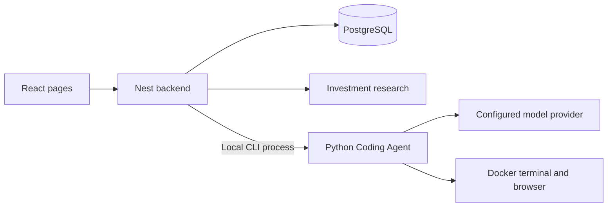

English | [简体中文](README.zh-CN.md)

# Daily Portfolio Analysis

A portfolio application with a local Coding Agent available at `/dev`.

## System boundaries

| Component | Entry point | Responsibility |
| --- | --- | --- |
| React client | `client/src/app.tsx` | Portfolio pages, research reports and the coding conversation |
| NestJS backend | `server/app.module.ts` | Authentication context, database access, investment research and local Agent process orchestration |
| Python Agent | `agent/src/agent_core/cli.py` | Coding loop, model routing, container tools and checkpoints; market-data client and evaluation commands |

Only the backend accesses business PostgreSQL data. The investment research pipeline lives in `server/modules/multi-agent/`; the agent that edits project source lives in `agent/src/agent_core/coder/`.



## Reading the code

| Area | Start here |
| --- | --- |
| Business request | `client/src/pages/` → `client/src/api/index.ts` → `server/modules/` |
| Shared contracts | `shared/api.interface.ts` |
| Coding task submission | `DevTaskComposer.tsx` → `client/src/api/dev-agent.ts` → `server/modules/dev-agent/` |
| Agent execution | `coder/cli.py` → `general_harness.py` → `react_loop.py` → `general_tools.py` / `extensions.py` |
| Models and integrations | `agent/src/agent_core/models/` and `coder/integrations/` |
| Isolation and rollback | `coder/runtime/`, `coder/checkpoints/` and `coder/workers.py` |

New tasks use v2 `GeneralHarness`. The older `harness.py` remains necessary for stored v1 tasks. See [agent/README.md](agent/README.md) for the current execution path and compatibility boundary.

## Local development

Requirements: Node.js 22+, npm 10+, Python 3.11+ and uv. Container tools require Docker. Existing installations only need the startup command.

```powershell
npm install
Set-Location agent
uv sync
Set-Location ..
npm run dev:local
```

Default addresses: frontend `http://localhost:8080`, backend `http://localhost:3000`, coding console `/dev`. The local launcher checks for an existing stack before starting another one.

- Root `.env.local`: backend, database and local identity; see [.env.local.example](.env.local.example). Enable the coding console with `AGENT_DEV_ENABLED=true`.
- `agent/.env`: model, vision, MCP and container configuration; see [agent/.env.example](agent/.env.example). Preserve existing values when copying examples.

Business pages require PostgreSQL and a matching user identity. See the [snapshot guide](db/snapshot/README.md) for initial database setup. [scripts/README.md](scripts/README.md) maps local, platform, database, build and sync commands.

Prepare the Coding Agent image on Windows with WSL Ubuntu:

```powershell
powershell -ExecutionPolicy Bypass -File scripts/coder-runtime/prepare.ps1
```

`npm run dev` dispatches through the platform-maintained `scripts/dev.sh`; it selects the sandbox or local launcher. Use `npm run dev:local` for ordinary local work in this checkout.

## Coding Agent behavior

The agent operates on an independent source copy using container terminals and a browser. It supports controlled network access, configured HTTP MCP servers, project Skills and isolated parallel workers. Source changes have checkpoints; target and regression evidence is tied to the current source revision. A reviewed candidate is revalidated in isolation before being applied to the main checkout.

There is no default task-wide iteration or duration cap. Per-command timeouts, resource limits and approvals for external writes remain. The `/dev` settings dialog contains model, MCP and runtime-capability tabs.

The business webapp and the Coding Agent have different deployment requirements. The complete Agent is currently local; see [Miaoda deployment boundaries](agent/DEPLOYMENT.md) for the existing constraints and the remote-worker design.

## Validation and local artifacts

```powershell
npm run type:check
npm run test:unit
npx playwright test -c playwright.runtime.config.ts
Set-Location agent
uv run python -m pytest -q
```

Runtime browser tests use the existing local stack with API fixtures. `npm run test:e2e:fullstack` uses isolated ports and a fake agent. Docker integration cases require explicit opt-in; real-model evaluation is available through `scripts/evaluate-coding-agent.py`.

| Path | Contents | Version control |
| --- | --- | --- |
| `client/`, `server/`, `shared/`, `agent/src/` | Source and contracts | Tracked |
| `scripts/`, `e2e/`, `agent/tests/` | Operational entry points and checks | Tracked |
| `agent/data/` | Task history, conversations and checkpoints | Runtime contents ignored |
| `output/`, `logs/`, `backups/` | Screenshots, evaluation evidence, logs and backups | Local and ignored |
| `docs/` | Local audits, designs and learning material | Intentionally ignored |

Local learning material is indexed in `docs/README.md`. Shared project documentation starts with this file, `agent/README.md` and `scripts/README.md`.

MIT License. Investment features are for record keeping and learning, not financial advice.
