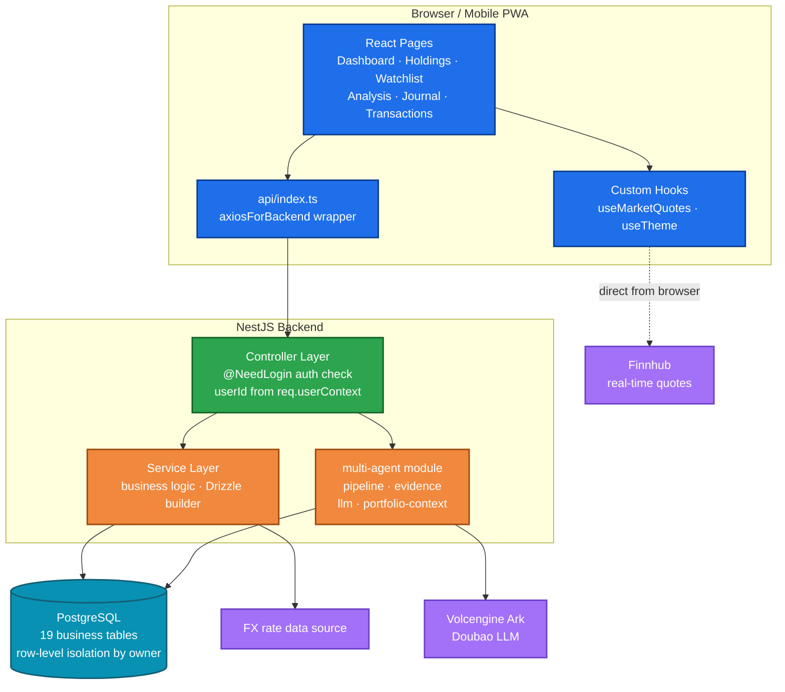

English | [简体中文](README.zh-CN.md)

# Daily Portfolio Analysis

Daily Portfolio Analysis is a full-stack stock portfolio management terminal. After each trading day closes, the system performs a health check on every holding, scans the watchlist for trading opportunities, and records the day's net-value snapshot and investment journal. For an individual stock, a multi-agent deep analysis can be run to produce a research report that includes a bull/bear debate and risk-control checks.

The system uses a decoupled front-end/back-end architecture. All business data is stored in a backend PostgreSQL database with row-level isolation per account. Logging in with the same account on desktop or mobile accesses the same data; historical ratings, transactions and deep reports are retained long term.

## Features

- **Dashboard**: account value, market value, cost, cumulative and daily P&L, with summaries by custom groups (e.g. *Alpha Picks* and *Self-managed* tracked separately).
- **Holdings**: per-stock rating, recommended action and target price; table view on desktop and card view on mobile.
- **Watchlist**: target entry prices and trading signals, with daily scans for buy/sell opportunities.
- **Daily Analysis**: one analysis card per holding and watchlist item, containing rating, action, target price, catalysts and risks.
- **Multi-Agent Deep Reports**: research reports with 14 sections (core thesis, financials, SOTP valuation, bull/bear debate, critic review, risk gates, PM decision, etc.); every run is retained as a new version with its generation time.
- **Realized P&L**: a Robinhood-style realized P&L summary on the transactions page, aggregated by stock and currency, replacing the former closed-positions list.
- **Strategy Rules**: risk-control rules (single-company exposure cap, leverage-ETF cap, cash buffer, stop-loss lines) configurable in the UI and enforced as hard gates during analysis.
- **Journal & Snapshots**: auto-generated five-part investment journals, with the net-value curve based on daily snapshots.
- **Multi-currency**: USD / HKD / CNY tracked in separate sub-accounts and consolidated via FX conversion.
- Dark mode, mobile safe-area support, and PWA "add to home screen".

## Architecture

### Overall Architecture

The front-end is a React SPA, the backend is NestJS, and the database is PostgreSQL. Market data is requested directly from Finnhub in the browser, and the API token is stored only on the local device. Reasoning in the multi-agent analysis is performed by the backend through the Volcengine Ark (Doubao) LLM; FX rates are fetched centrally by the backend FX module.



### Request Flow

All backend endpoints follow a uniform layered design, illustrated by the holdings API:

- The controller layer rejects anonymous requests via `@NeedLogin()`; userId is obtained from `req.userContext` and never accepted from client input.
- The service layer accesses the database through the injected `DRIZZLE_DATABASE` handle; every query includes the `owner = userId` condition to prevent cross-account access.

```mermaid
flowchart LR
    Page["Page component<br/>e.g. HoldingsPage"]:::fe
    Api["api/index.ts<br/>axiosForBackend"]:::fe
    Ctrl["HoldingsController<br/>@NeedLogin()"]:::ctrl
    Svc["HoldingsService"]:::svc
    Drizzle["Drizzle ORM"]:::drv
    PG[("holdings table")]:::db

    Page -->|"fetchHoldings()"| Api
    Api -->|"GET /api/portfolio/holdings"| Ctrl
    Ctrl -->|"req.userContext.userId"| Svc
    Svc -->|"db.select()...<br/>where(owner = userId)"| Drizzle
    Drizzle --> PG
    PG -->|"rows"| Svc
    Svc -->|"mapRow → ListResponse"| Page

    classDef fe fill:#1f6feb,stroke:#0b3d91,color:#ffffff,stroke-width:2px
    classDef ctrl fill:#2da44e,stroke:#116329,color:#ffffff,stroke-width:2px
    classDef svc fill:#f0883e,stroke:#9e4b0f,color:#ffffff,stroke-width:2px
    classDef drv fill:#bf5af2,stroke:#8957e5,color:#ffffff,stroke-width:2px
    classDef db fill:#0891b2,stroke:#155e75,color:#ffffff,stroke-width:2px
```

- Types shared between front-end and backend (e.g. `Holding`, `CreateHoldingDto`, `ListResponse<T>`) are defined centrally in `shared/api.interface.ts`.



### Multi-Agent Pipeline

A deep analysis of one stock consists of five stages. Each stage writes its status back to `agent_runs`, allowing the front-end to poll and display progress, and the run can be cancelled at any time.


The deep report contains 14 sections rendered by `client/src/components/MultiAgent/DeepReportView.tsx`; data is fetched via `GET /api/multi-agent/deep-report/:runId`.

## Project Structure

```
.
├── client/                 # React front-end
│   └── src/
│       ├── pages/          # business pages (grouped by feature)
│       ├── components/
│       │   ├── MultiAgent/ # deep reports, run cards, rating badges
│       │   ├── ui/         # base components (shadcn style)
│       │   └── business-ui/# business selectors (users / departments / chats)
│       ├── hooks/          # quote polling, theme, mobile detection
│       └── api/index.ts    # front-end wrappers for backend endpoints
├── server/                 # NestJS backend
│   ├── database/schema.ts  # Drizzle schema (auto-generated, do not edit)
│   ├── common/             # exception filters, shared constants
│   └── modules/            # business modules (controller + service + module)
├── shared/
│   └── api.interface.ts    # types shared by front-end and backend
└── scripts/                # dev / build / lint scripts
```

## Data Model

The database contains 19 tables in three groups:

| Group | Tables | Description |
|---|---|---|
| Core business | `holdings`, `watchlist`, `transactions`, `closed`, `analysis`, `groups`, `journal`, `snapshots`, `alpha_picks`, `cash_accounts`, `fx_rates` | Holdings, watchlist, transactions, daily analysis, groups, journal, net-value snapshots, etc. |
| Multi-agent | `agent_runs`, `agent_evidence`, `bull_bear_arguments`, `debate_records`, `agent_ratings`, `risk_gate_results`, `agent_audit_log`, `deep_report` | Full-process data of analysis runs and the final deep reports |
| Configuration | `strategy_rules` | Risk-control rules; UI supports create/edit and enable/disable |

The table structure is defined in `server/database/schema.ts`. This file is auto-generated from the database by platform tooling (`npm run gen:db-schema`) and should not be edited manually.

## Local Development

Requirements: Node.js >= 22 and npm >= 10. On Windows the dev/build scripts are shell scripts and must be run through Git Bash.

```bash
# Install dependencies
npm install

# Copy the environment template and fill in as needed
cp .env.example .env
#   The app runs without DOUBAO_API_KEY; only the multi-agent LLM reasoning is disabled
#   Set DATABASE_URL when using your own PostgreSQL

# Start backend (NestJS) and front-end (Vite) together
npm run dev

# Or start them separately
npm run dev:server   # http://localhost:3000
npm run dev:client   # http://localhost:8080
```

`npm run dev` runs `scripts/dev.js`, which supervises the front-end and backend processes: crashed processes restart automatically, with exponential backoff under repeated failures; logs are written per process under `logs/`; on exit, process groups are cleaned up and occupied ports are released.

Production build and start:

```bash
npm run build
npm start
```

## Configuration

- **Finnhub token**: never stored in the database or sent to the server. After configuration in the UI it is kept in the current device's browser `localStorage`; it must be configured again on another device.
- **Doubao LLM**: set `DOUBAO_API_KEY` in `.env`; the model and base URL can also be overridden via environment variables, see `.env.example`.
- **Platform dependency**: the project relies on the `@lark-apaas/*` packages for hosting, auth and database injection. To run fully standalone, replace auth, database connection and build configuration with your own implementations; the business module code can be kept as-is.

## Disclaimer

This project is intended for personal record-keeping and learning purposes only. It does not constitute investment advice; gains and losses resulting from its use are the sole responsibility of the user.

## License

[MIT](LICENSE)
