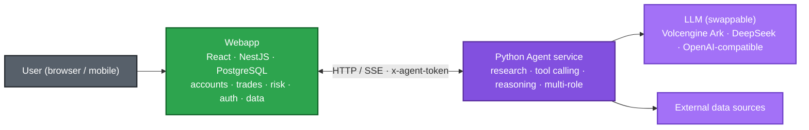
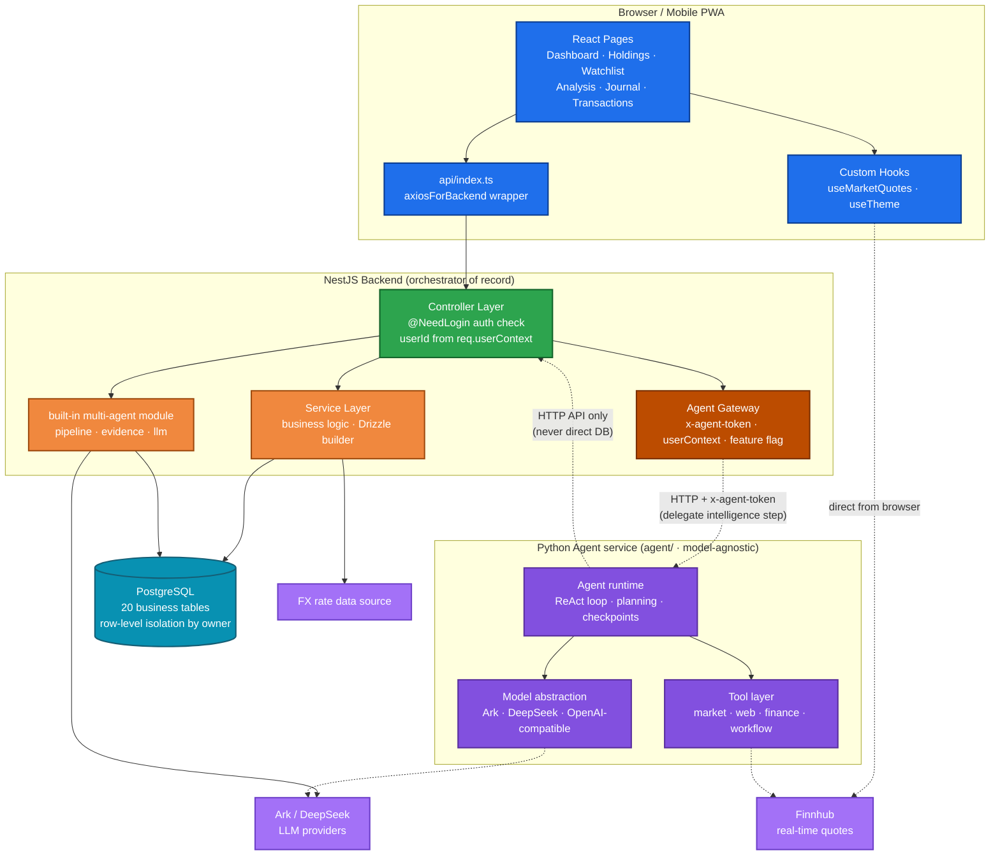
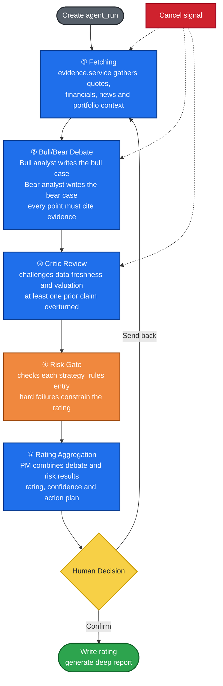
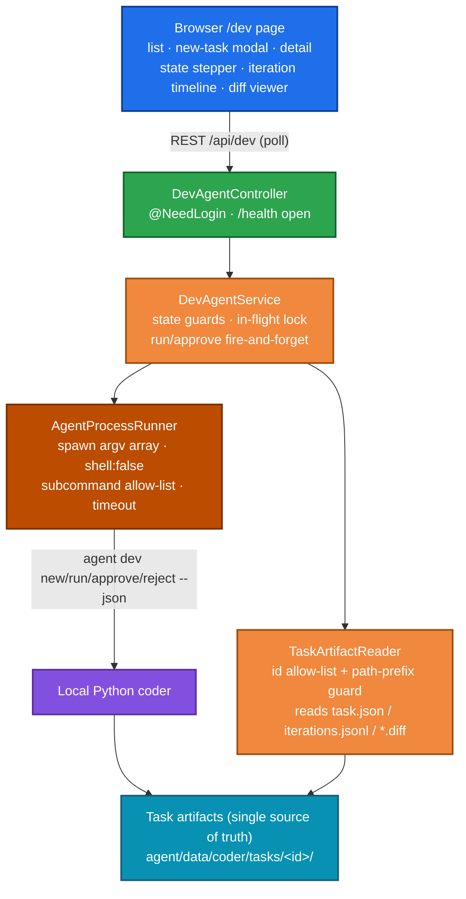

English | [简体中文](README.zh-CN.md)

# Daily Portfolio Analysis

Daily Portfolio Analysis is a full-stack stock portfolio management terminal. After each trading day closes, the system performs a health check on every holding, scans the watchlist for trading opportunities, and records the day's net-value snapshot and investment journal. For an individual stock, a multi-agent deep analysis can be run to produce a research report that includes a bull/bear debate and risk-control checks.

The system uses a decoupled front-end/back-end architecture. All business data is stored in a backend PostgreSQL database with row-level isolation per account. Logging in with the same account on desktop or mobile accesses the same data; historical ratings, transactions and deep reports are retained long term.

The system has two parts: a full-stack trading terminal (NestJS + React + PostgreSQL) that is the system of record for accounts, transactions, ratings and reports, and a standalone Python agent service under `agent/` that handles reasoning tasks such as market queries, research and analysis. The backend is the sole orchestrator and data gateway, delegating reasoning to the agent over a protected HTTP API. The agent is model-agnostic — it can switch between Volcengine Ark, DeepSeek or any OpenAI-compatible endpoint — and never touches the business database directly.

## Features

- **Dashboard**: account value, market value, cost, cumulative and daily P&L, with summaries by custom groups (e.g. *Alpha Picks* and *Self-managed* tracked separately).
- **Holdings**: per-stock rating, recommended action and target price; table view on desktop and card view on mobile.
- **Watchlist**: target entry prices and trading signals, with daily scans for buy/sell opportunities.
- **Daily Analysis**: one analysis card per holding and watchlist item, containing rating, action, target price, catalysts and risks.
- **Multi-Agent Deep Reports**: research reports with 14 sections (core thesis, financials, SOTP valuation, bull/bear debate, critic review, risk gates, PM decision, etc.); every run is retained as a new version with its generation time.
- **Standalone Python Agent service** (`agent/`): a model-agnostic service (Volcengine Ark / DeepSeek / any OpenAI-compatible API) with tool calling, planning, checkpoints, replayable runs and multi-agent orchestration; it reaches business data only through the backend HTTP API, never the database directly.
- **Local coding-agent console** (`/dev`): a second agent persona that reproduces, diagnoses and patches the webapp under a controlled inner loop (reproduce → diagnose → patch → gated verification, with automatic rollback). The NestJS dev module spawns the local Python agent with an allow-listed command set and no shell, treating on-disk task artifacts as the single source of truth; the browser drives the loop and requires an explicit approve/reject for every change. The full-stack E2E runs against a deterministic fake agent on isolated ports, so it never touches a running dev stack or calls an LLM.
- **Realized P&L**: a Robinhood-style realized P&L summary on the transactions page, aggregated by stock and currency, replacing the former closed-positions list.
- **Strategy Rules**: risk-control rules (single-company exposure cap, leverage-ETF cap, cash buffer, stop-loss lines) configurable in the UI and enforced as hard gates during analysis.
- **Journal & Snapshots**: auto-generated five-part investment journals, with the net-value curve based on daily snapshots.
- **Multi-currency**: USD / HKD / CNY tracked in separate sub-accounts and consolidated via FX conversion.
- Dark mode, mobile safe-area support, and PWA "add to home screen".

## Architecture

### Overall Architecture

The front-end is a React SPA, the backend is NestJS, and the database is PostgreSQL. Market data is requested directly from Finnhub in the browser, and the API token is stored only on the local device. Reasoning in the multi-agent analysis is performed by the backend through the Volcengine Ark (Doubao) LLM; FX rates are fetched centrally by the backend FX module.

The system boundary at a glance:



The backend is the only system of record; the agent fetches data and produces analysis through controlled interfaces and never reads or writes the database directly. The detailed components and data flows are below.



### Agent Reasoning: the Built-in Pipeline and the Standalone Service

Reasoning lives in two places: a production pipeline embedded in the backend, and a standalone service that factors that intelligence out. They have distinct responsibilities:

- **Built-in analysis pipeline (NestJS)** — the implementation running daily today: a fixed five-stage pipeline (fetch → bull/bear debate → critic → risk gate → rating) that calls the LLM directly from the backend and produces the 14-section deep reports.
- **Standalone Python Agent service (`agent/`)** — a separate service that takes reasoning out of the business backend. It relies on no heavyweight agent framework; tool calling, planning, checkpoints and multi-agent orchestration are implemented in this repository so they are easy to debug and extend. The model layer is provider-agnostic and can switch between Volcengine Ark, DeepSeek or any OpenAI-compatible endpoint.

The boundary between them is deliberate. NestJS owns auth, the database, transactions, permissions and the UI, and is the only component that writes to the database. The Python agent never connects to the business database; it reads data from the backend through an Agent Gateway secured by `x-agent-token` (with the user identity injected server-side), and the backend delegates only the reasoning steps. Swapping models, changing reasoning logic or rewriting the agent therefore never affects accounts or data, and the agent can be developed and tested independently.

### Request Flow

All backend endpoints follow a uniform layered design, illustrated by the holdings API:

- The controller layer rejects anonymous requests via `@NeedLogin()`; userId is obtained from `req.userContext` and never accepted from client input.
- The service layer accesses the database through the injected `DRIZZLE_DATABASE` handle; every query includes the `owner = userId` condition to prevent cross-account access.

```mermaid
flowchart LR
    Page["Page component<br/>e.g. HoldingsPage"]:::fe
    Api["api/index.ts<br/>axiosForBackend"]:::fe
    Ctrl["HoldingsController<br/>@NeedLogin()"]:::ctrl
    Svc["HoldingsService"]:::svc
    Drizzle["Drizzle ORM"]:::drv
    PG[("holdings table")]:::db

    Page -->|"fetchHoldings()"| Api
    Api -->|"GET /api/portfolio/holdings"| Ctrl
    Ctrl -->|"req.userContext.userId"| Svc
    Svc -->|"db.select()...<br/>where(owner = userId)"| Drizzle
    Drizzle --> PG
    PG -->|"rows"| Svc
    Svc -->|"mapRow → ListResponse"| Page

    classDef fe fill:#1f6feb,stroke:#0b3d91,color:#ffffff,stroke-width:2px
    classDef ctrl fill:#2da44e,stroke:#116329,color:#ffffff,stroke-width:2px
    classDef svc fill:#f0883e,stroke:#9e4b0f,color:#ffffff,stroke-width:2px
    classDef drv fill:#bf5af2,stroke:#8957e5,color:#ffffff,stroke-width:2px
    classDef db fill:#0891b2,stroke:#155e75,color:#ffffff,stroke-width:2px
```

- Types shared between front-end and backend (e.g. `Holding`, `CreateHoldingDto`, `ListResponse<T>`) are defined centrally in `shared/api.interface.ts`.



### Multi-Agent Pipeline

A deep analysis of one stock consists of five stages. Each stage writes its status back to `agent_runs`, allowing the front-end to poll and display progress, and the run can be cancelled at any time.



The deep report contains 14 sections rendered by `client/src/components/MultiAgent/DeepReportView.tsx`; data is fetched via `GET /api/multi-agent/deep-report/:runId`.

### Local Coding Agent Console

Beyond the investment persona, the Python agent carries a `coder` persona that develops and fixes the webapp itself. It runs the same state-machine inner loop as an autonomous coding task — reproduce the failing check, diagnose the root cause, propose a patch, verify, and roll back with the failure evidence if verification fails — under iteration/call/time budgets and a hard gate that never weakens tests to force a pass.

The console is deliberately a **local development tool, not a cloud feature**. The cloud runtime is a read-only FaaS container without git, Python or dev dependencies and with an execution time cap, so it cannot host a "change code and run tests" workload. The feature is therefore off by default and enabled only in local development with `AGENT_DEV_ENABLED=true`.



Three design choices keep the boundary small and safe:

- **On-disk artifacts are the single source of truth; no database table, no resident service.** The backend spawns the local `agent` binary on demand and reads the artifacts the Python side already writes atomically, so the CLI and the browser always show the same state and a task can be replayed or audited.
- **Subprocesses are locked down.** Commands are an argv array with `shell:false` (shell injection is impossible), restricted to the `new/run/approve/reject` subcommands, run in a fixed working directory with a timeout; the Python side adds its own npm/git allow-list and forbids `commit/push/reset/clean`.
- **Human-in-the-loop is mandatory.** A patch is written to `patches/*.diff` and stays unapplied at the approval gate; approving applies it and runs verification, rejecting requires a reason, and the system never commits or pushes automatically.

The backend module is an anti-corruption layer: its TypeScript types mirror the Python models field by field, inputs are validated against id allow-lists and path prefixes to prevent traversal, and failures map to standard HTTP status (503 disabled / 400 invalid / 404 missing / 409 state conflict / 500 subprocess failure). The full-stack E2E uses a zero-dependency deterministic fake agent in a temp artifact directory and isolated ports (Nest 3099 / Vite 8090, `strictPort`, never reused), covering the approve and reject end-to-end flows without an LLM.

## Project Structure

```
.
├── agent/                  # Python Agent service (model-agnostic, Typer/FastAPI)
│   ├── src/agent_core/     # model layer, tools, webapp client, coder/ inner loop
│   ├── tests/              # pytest + pytest-httpx (no live network)
│   ├── data/checkpoints/   # JSONL checkpoints (runtime; kept empty in git)
│   └── pyproject.toml
├── client/                 # React front-end
│   └── src/
│       ├── pages/          # business pages (grouped by feature), incl. Dev/
│       ├── components/
│       │   ├── MultiAgent/ # deep reports, run cards, rating badges
│       │   ├── ui/         # base components (shadcn style)
│       │   └── business-ui/# business selectors (users / departments / chats)
│       ├── hooks/          # quote polling, theme, mobile detection
│       └── api/index.ts    # front-end wrappers for backend endpoints
├── e2e/                    # Playwright: app-boot smoke + fullstack/ (fake agent)
│   └── fixtures/           # deterministic fake-agent.cjs for the dev console
├── server/                 # NestJS backend (orchestrator of record)
│   ├── database/schema.ts  # Drizzle schema (auto-generated, do not edit)
│   ├── common/
│   │   ├── middleware/     # local dev identity injection (LOCAL_DEV_USER_ID gate)
│   │   └── filters/        # global exception filter
│   └── modules/            # business modules (controller + service + module),
│                           # incl. dev-agent/ (spawn local coder, read artifacts)
├── shared/
│   └── api.interface.ts    # types shared by front-end and backend
├── db/
│   └── snapshot/           # local real-data snapshot (*.sql gitignored, local only)
├── drizzle/                # drizzle-kit generated table migrations
├── playwright.config.ts         # Vite-only smoke e2e (ignores fullstack/)
├── playwright.fullstack.config.ts # isolated fullstack e2e (Nest 3099 / Vite 8090)
└── scripts/
    ├── db/                 # local PostgreSQL: schema/roles + start/stop/rebuild
    ├── dev-local-*.ps1     # Windows one-click local launch (minimal / db / full / client)
    ├── dev-e2e-server.js   # build + boot Nest with the fake agent for fullstack e2e
    └── sync-from-miaoda.ps1# Miaoda -> GitHub sync
```

## Data Model

The database contains 20 tables in three groups:

| Group | Tables | Description |
|---|---|---|
| Core business | `holdings`, `watchlist`, `transactions`, `closed`, `analysis`, `groups`, `journal`, `snapshots`, `alpha_picks`, `cash_accounts`, `fx_rates` | Holdings, watchlist, transactions, daily analysis, groups, journal, net-value snapshots, etc. |
| Multi-agent | `agent_runs`, `agent_evidence`, `bull_bear_arguments`, `debate_records`, `agent_ratings`, `risk_gate_results`, `agent_audit_log`, `deep_report` | Full-process data of analysis runs and the final deep reports |
| Configuration | `strategy_rules` | Risk-control rules; UI supports create/edit and enable/disable |

The table structure is defined in `server/database/schema.ts`. This file is auto-generated from the database by platform tooling (`npm run gen:db-schema`) and should not be edited manually.

## Local Development

Requirements: Node.js >= 22 and npm >= 10. Three modes are available:

| Mode | How to start | Database | Auth | Best for |
| --- | --- | --- | --- | --- |
| Official cloud mode | `npm run dev` | Miaoda-managed PostgreSQL | `lark-cli` + account login | An environment identical to production |
| Minimal offline mode | `scripts/dev-local-minimal.ps1` | skipped (no DB) | none | Public market-data endpoints only (early agent work) |
| **Full offline mode (recommended)** | `scripts/dev-local-full.ps1` | **local PostgreSQL + real data snapshot** | injected local user | Full UI with real data, agent development & demos |

### Full offline mode: local PostgreSQL with real data (recommended)

This mode reproduces the platform runtime entirely on your machine, so you can see your **real holdings without logging in or reaching the Miaoda cloud** — ideal for offline agent development and interviews. It does four things:

1. **Tables**: generates DDL from `server/database/schema.ts` with drizzle-kit and creates the tables under a dedicated `workspace_*` schema (`scripts/db/02_tables.sql`).
2. **Roles**: recreates the three datapaas roles the platform switches to per request (`service_role_/authenticated_/anon_<schema>` in `scripts/db/03_roles.sql`).
3. **Data**: imports the real data snapshot exported from Miaoda (`db/snapshot/*.sql`, **personal data, gitignored and never committed**).
4. **Identity**: the backend connects through `SUDA_DATABASE_URL`; a local middleware (`server/common/middleware/local-dev-auth.middleware.ts`) that is only active when `LOCAL_DEV_USER_ID` is set injects the gateway user header, so the `@NeedLogin()` guard passes and `owner` row-level isolation behaves exactly as in the cloud.

One-time setup:

```powershell
# 1) Install PostgreSQL (user-scoped scoop install, no admin needed)
scoop install postgresql

# 2) Put the seven exported *.sql files into db/snapshot/ (see db/snapshot/README.md)

# 3) One-click: create database -> tables/roles -> import snapshot (idempotent)
powershell -ExecutionPolicy Bypass -File scripts\db\rebuild-local.ps1
```

Start it in either of two ways:

```powershell
# Option A — one PowerShell script, self-contained: it starts PostgreSQL,
# auto-detects the owner id, injects every local env var inline, and opens the
# backend and frontend in two windows.
powershell -ExecutionPolicy Bypass -File scripts\dev-local-full.ps1
# then open http://127.0.0.1:8080

# Option B — single-window launcher (the Miaoda dev-local entry), driven by a
# gitignored .env.local instead of inline variables:
Copy-Item .env.local.example .env.local   # fill in LOCAL_DEV_USER_ID (see the file)
npm run dev:local                          # = node scripts/dev-local.js
# then open http://localhost:8080
```

Both paths run the same NestJS (3000) + Vite (8080) stack. The npm scripts set
`NODE_ENV` through `cross-env`, so they work on Windows PowerShell, macOS and
Linux. The local variables are documented in `.env.local.example`; the important
ones are:

- `SUDA_DATABASE_URL` — the datapaas connection string; the `?schema=<workspace>`
  query param is the RLS role suffix.
- `LOCAL_DEV_USER_ID` — the snapshot owner id (Option A auto-detects it; Option B
  reads it from `.env.local`). The middleware is completely inert when this is
  unset and never overrides a real gateway header, so it has zero effect on
  production. Another owner's row in the same snapshot is correctly filtered out.
- `DISABLE_CSRF=true` — the local Vite frontend has no gateway cookie session;
  production keeps CSRF enabled when the variable is absent.
- `FORCE_AUTHN_INNERAPI_DOMAIN` — a placeholder required at construction time;
  local data/auth do not call the platform inner API.

### Testing

```bash
npm run test:unit          # Vitest: unit tests under server/**/*.spec.ts (no Nest/DB)
npm run test:unit:watch    # watch mode
npm run test:unit:coverage # coverage report (V8)

npm run test:e2e:install   # one-time: download the Playwright Chromium browser
npm run test:e2e           # Vite-only smoke: the front-end bundle mounts
npm run test:e2e:fullstack # full-stack: coding-console approve/reject flows
npm run test:e2e:ui        # interactive Playwright UI for debugging

cd agent && pytest -q      # Python agent tests (offline; no live network)
```

Unit tests exercise business logic and the dev-agent module with mocked
process runners and artifact readers; they do not boot NestJS or touch the
database. The Vite-only e2e asserts the front-end bundle mounts without an
error boundary. The full-stack e2e boots an isolated Nest + Vite pair
(ports 3099/8090, never reused) against a deterministic fake agent and a temp
artifact directory, so it drives the real browser through the coding console's
approve/reject flows with no LLM calls, no database and no interference with a
running dev stack. The Python agent tests are fully offline using scripted
models and recorded HTTP.

### Official cloud mode

```bash
# Install dependencies
npm install

# Copy the environment template and fill in as needed
cp .env.example .env
#   The app runs without DOUBAO_API_KEY; only the multi-agent LLM reasoning is disabled

# Start backend (NestJS) and front-end (Vite) together; needs lark-cli for env pull
npm run dev

# Or start them separately
npm run dev:server   # http://localhost:3000
npm run dev:client   # http://localhost:8080
```

`npm run dev` runs `scripts/dev.js`, which supervises the front-end and backend processes: crashed processes restart automatically, with exponential backoff under repeated failures; logs are written per process under `logs/`; on exit, process groups are cleaned up and occupied ports are released.

Production build and start:

```bash
npm run build
npm start
```

### Python Agent (`agent/`)

The agent uses Python 3.12 and [uv](https://docs.astral.sh/uv/).

```bash
cd agent
uv sync                       # create .venv and install deps
cp .env.example .env          # fill in ARK_API_KEY / DEEPSEEK_API_KEY
uv run agent health           # check the webapp client
uv run agent quote AAPL       # fetch a real quote through the webapp
uv run pytest -q              # run the offline test suite
```

The agent talks to the webapp over HTTP (`WEBAPP_BASE_URL` in `agent/.env`); it does not need its own database connection.

## Cloud (Miaoda) <-> GitHub Sync

The webapp is mainly developed with AI on the Miaoda (aPaaS) cloud, which is the source of truth for the NestJS/React app and is not a git repository. To keep GitHub in sync, run the one-way sync script — it exports the latest committed cloud snapshot via `lark-cli`, overwrites only the cloud-owned paths, then commits and pushes:

```powershell
powershell -ExecutionPolicy Bypass -File scripts\sync-from-miaoda.ps1 -DryRun   # preview only
powershell -ExecutionPolicy Bypass -File scripts\sync-from-miaoda.ps1           # sync + commit + push
```

It mirrors `client/`, `server/`, `shared/`, `.githooks/`, `.spark/` and the root config files, but never touches `agent/`, `docs/`, `README*`, `.gitignore`, `.env` or `*.sql`. It takes a local safety-net commit before overwriting, so no local work is lost. Uncommitted cloud sandbox edits are not exported — publish/commit in Miaoda first.

## Configuration

- **Finnhub token**: never stored in the database or sent to the server. After configuration in the UI it is kept in the current device's browser `localStorage`; it must be configured again on another device.
- **Doubao LLM**: set `DOUBAO_API_KEY` in `.env`; the model and base URL can also be overridden via environment variables, see `.env.example`.
- **Platform dependency**: the project relies on the `@lark-apaas/*` packages for hosting, auth and database injection. To run fully standalone, replace auth, database connection and build configuration with your own implementations; the business module code can be kept as-is.

## Disclaimer

This project is intended for personal record-keeping and learning purposes only. It does not constitute investment advice; gains and losses resulting from its use are the sole responsibility of the user.

## License

[MIT](LICENSE)
