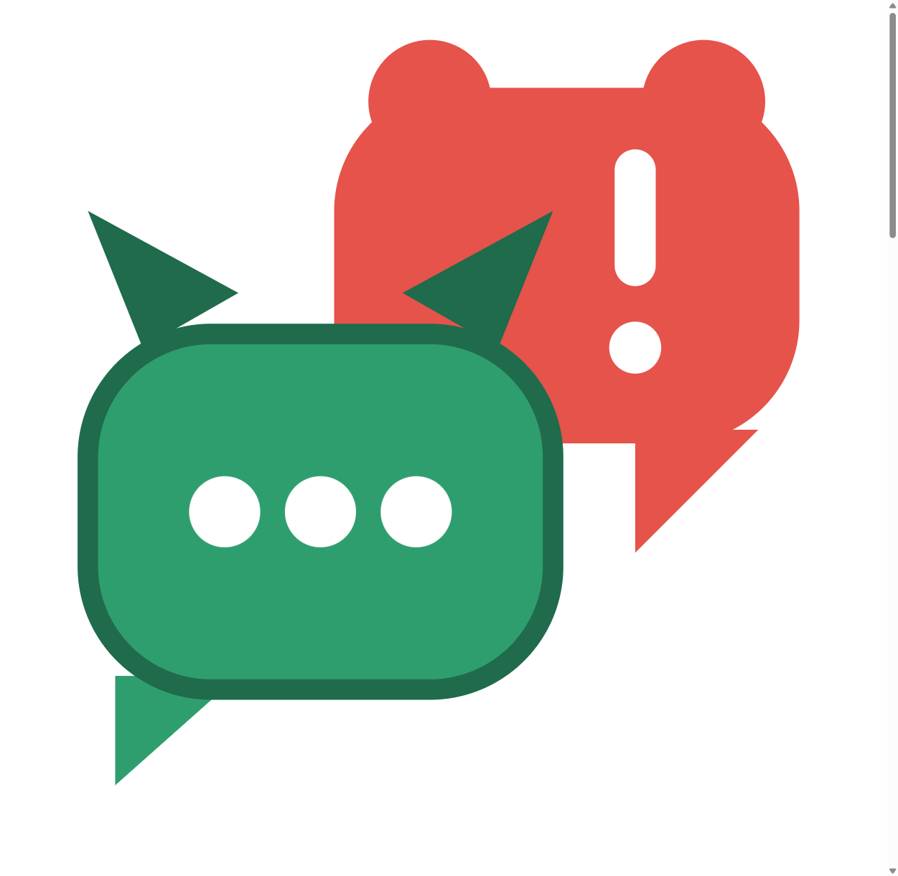
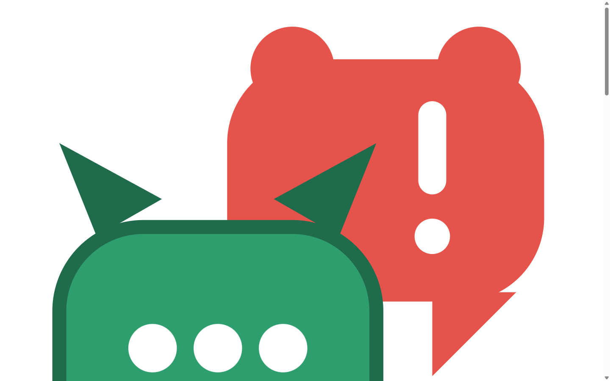
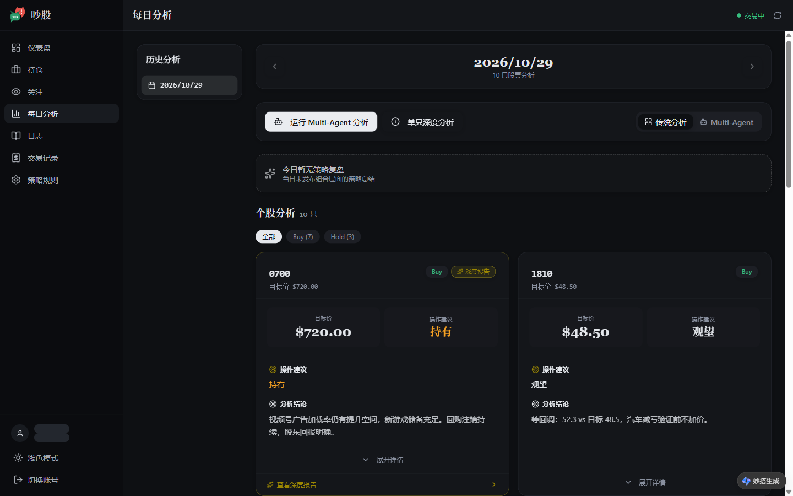
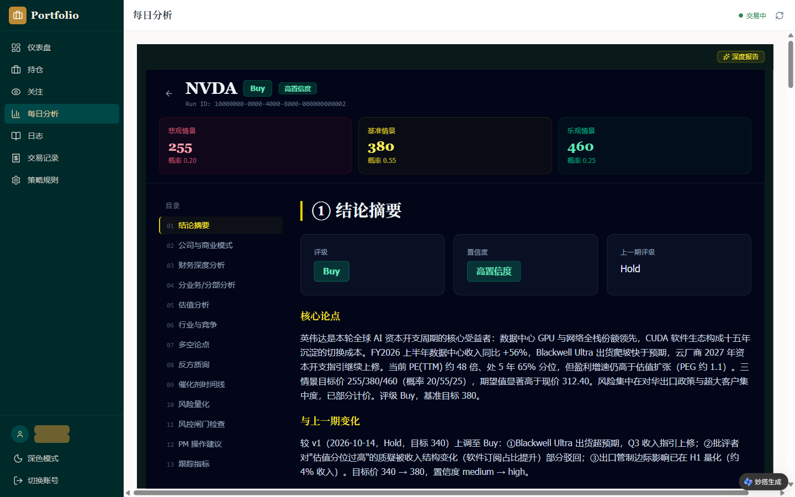

English | [简体中文](README.zh-CN.md)

<div align="center">


# 吵股 Squabble

**Let your AI analysts argue. You decide.**

An open-source portfolio terminal where a team of AI analysts — a bull, a bear,
a critic, a risk gate and a PM — **debates your holdings into research
reports**, watches the market around the clock, and paper-trades with hard risk
gates.

Self-hosted. No phone number, no email verification, zero telemetry — see
[our privacy stance](docs/privacy.md).

[](LICENSE)
[](docker-compose.yml)
[](CONTRIBUTING.md)

</div>



<details>
<summary><b>More screenshots</b> (paper trading · daily analysis · deep research report)</summary>





</details>

## What it does

| | |
|---|---|
| 🗣️ **AI-Debated Research Reports** | Pick any stock. A bull and a bear argue over it — every point must cite evidence — a critic overturns the weak claims, your risk rules run as hard gates, and a PM rolls it into a **14-section research report**. Re-run it and you can see how the view changed, and *why*. Daily health checks, watchlist scans, journals and realized P&L included. |
| 🤖 **24/7 AI Paper Trading** | A fully isolated paper account where an AI agent watches the markets around the clock, trades on the signals from your own research ratings, and pushes a notification (Webhook / Bark / Server酱 / SMTP / Telegram) every time it fills. Hard guardrails: daily-loss circuit breaker, per-order caps, per-day caps — and no real-broker code path exists anywhere. Connect your own AI assistant (Claude / ChatGPT) via MCP with per-agent spending limits and approval modes. |
| 🔒 **Zero Personal Data** | Self-hosted, zero telemetry, username+password only (no phone number, no email verification). The only outbound calls are the ones you make with **your own API keys**. |

## Try it in 5 minutes

```bash
git clone https://github.com/Lueyu/squabble.git
cd squabble
docker compose up --build
```

Open **http://localhost:3000** and log in with the built-in demo account
(**demo / demo1234** — one click fills it on the login page). You get a
fictional portfolio to explore: 6 holdings across US/HK/CN markets, 3
completed agent runs (including a two-version NVDA report where the rating
upgraded Hold → Buy, with the losing bear argument preserved), and one
triggered risk gate. The demo account is seeded by the database initializer —
change or drop it for a public deployment.

**No API keys needed.** The demo runs fully offline. When you're ready to run
analyses on real stocks, you bring your own LLM key — any OpenAI-compatible
endpoint works (Ark / DeepSeek / and friends), and a Finnhub token for live
quotes. Details: [self-hosting guide](docs/self-hosting.md).

> 🧡 It's free and open source. Your only real cost is the LLM tokens from
> your own key — a deep report typically costs less than a coffee.

## Roadmap

- ✅ Multi-agent research reports (bull/bear debate, critic, risk gates, versioned)
- ✅ One-command Docker demo with fictional data
- ✅ **First-party accounts** — username + password (bcrypt), JWT sessions, no phone number, no email verification, registration toggle via env
- ✅ **AI paper trading** — signal-driven watchbot with hard guardrails (daily-loss circuit breaker, per-order/per-day caps), market-clock aware, and push notifications on fills (Webhook / Bark / Server酱 / SMTP / Telegram); **MCP server** for connecting external AI agents (Claude / ChatGPT) with per-agent spending limits, read/trade permissions and approval modes
- ✅ **Portfolio import** — generic CSV with auto column mapping + GBK support, broker presets (Robinhood / Futu / Tiger / Xueqiu), and broker-screenshot OCR powered by your own multimodal key
- 🔜 **Desktop app** — one-click installer; download counts via GitHub Releases, no telemetry

## FAQ

<details>
<summary><b>Is it free?</b></summary>

Yes — MIT-licensed open source. You pay only for LLM tokens from your own key,
and only when you run analyses.

</details>

<details>
<summary><b>Where does my data go?</b></summary>

Nowhere, unless you ask it to. Everything lives in the PostgreSQL on your own
machine. Outbound requests are limited to: your LLM provider (your key), market
quotes, and any notification channel you configure. The full breakdown is in
[docs/privacy.md](docs/privacy.md) — every claim is verifiable against the
open source code.

</details>

<details>
<summary><b>Does it place real trades?</b></summary>

No. Trading in Squabble is **paper trading only**: simulated orders in
dedicated tables, fully isolated from your real records. The broker adapter
interface exists so a real broker *could* be plugged in someday — domestic
brokers don't offer personal trading APIs, and we won't touch gray areas.

</details>

<details>
<summary><b>Can I use it on my phone?</b></summary>

Yes — the web app is a PWA with mobile layouts and "add to home screen"
support.

</details>

<details>
<summary><b>Which markets does it support?</b></summary>

US, HK and CN, with multi-currency sub-accounts (USD / HKD / CNY) consolidated
via FX conversion.

</details>

<details>
<summary><b>Why the name?</b></summary>

吵股 (chǎo gǔ) is a homophone of 炒股 ("trading stocks") where 吵 means "to
argue" — because that's literally what the product does: AI analysts arguing
over your stocks until a rating survives. The logo is a bull bubble calmly
typing its case while the bear bubble shouts back.

</details>

## Documentation

- [Self-hosting guide](docs/self-hosting.md) — Docker, environment variables, backup & restore, reverse proxy
- [Privacy](docs/privacy.md) — exactly what data exists and what leaves your machine
- [Portfolio import guide](docs/import.md) — CSV, Robinhood CSV and broker-screenshot OCR
- [Architecture](docs/architecture.md) — components, request flow, multi-agent pipeline, data model
- [Development guide](docs/development.md) — running from source, lint/tests, the Python agent, design tokens
- [Contributing](CONTRIBUTING.md) · [Security policy](SECURITY.md)

## Disclaimer

This project is for personal record-keeping and learning only. It does not
constitute investment advice; paper trading outcomes do not predict real
results. Gains and losses resulting from its use are the sole responsibility
of the user.

## License

[MIT](LICENSE)
