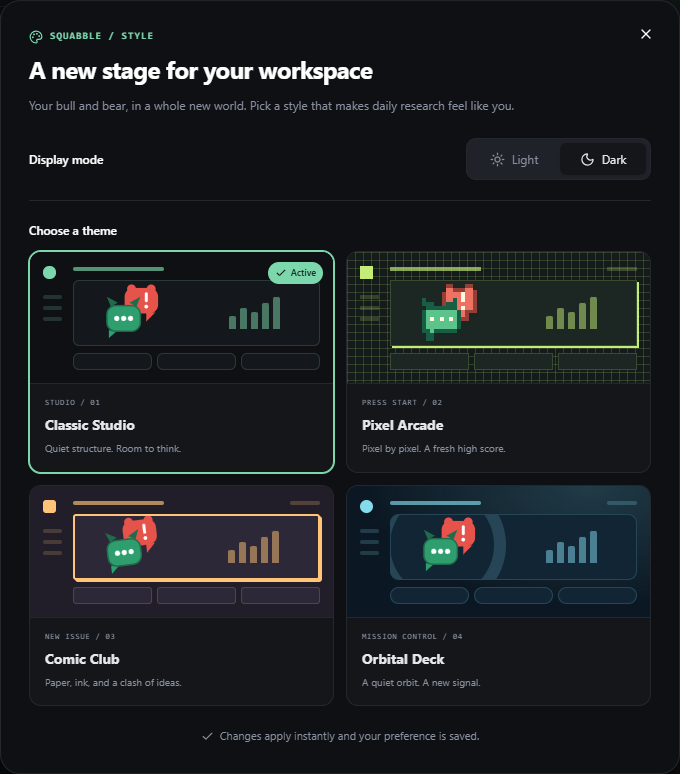

English | [简体中文](README.zh-CN.md)

<div align="center">


# Squabble · 吵股

**Let your AI argue. You decide.**

Build your own investing agent without writing code.
Bring your portfolio, set your rules, and try ideas in paper trading.

**US · Hong Kong · China A-shares** · **English / 中文** · **Self-hosted**

[](LICENSE)
[](https://github.com/Lueyu/squabble/actions/workflows/ci.yml)

[Start locally](#start-locally) · [What to try](#your-first-session) · [Setup guide](docs/self-hosting.md) · [Data & privacy](docs/privacy.md)

</div>


*A fictional demo portfolio, shown in the English interface.*

Squabble gives individual investors one workspace to **understand their holdings, test their rules, and review their decisions**. Start with free basic analysis and public quotes. Connect a model when you want a bull, a bear and a critic to challenge an investment idea.

## Why Squabble?

| You want to… | Squabble helps you… |
|---|---|
| Understand your whole portfolio | Track US/HK/CN holdings, cash and P&L together, with USD/HKD/CNY conversion and a market overview. |
| Build an agent without coding | Choose a template, set symbols, price triggers and risk limits, then preview and activate your paper strategy. |
| See the case on both sides | With a model configured, read bullish and bearish arguments, evidence, critique and risk checks in one report. Missing inputs stay visible. |
| Discuss a decision with your team | Configure a researcher, challenger and portfolio manager; add your own notes in the Research room and keep versioned conclusions with evidence. |
| Keep the final decision | Test in an isolated paper account. Receive optional trade proposals, execute real trades yourself, and record what actually happened. |

## Start locally

Choose one of two local installation paths. Neither requires a brokerage
connection or an AI API key for basic analysis.

| Path | What you need | Data location |
|---|---|---|
| **Desktop app** | A matching Windows x64 or macOS Intel/Apple silicon installer from [Releases](https://github.com/Lueyu/squabble/releases), when published | Squabble's application data directory on your computer |
| **Docker Compose** | [Git](https://git-scm.com/downloads/) and [Docker with Compose](https://docs.docker.com/get-started/get-docker/) | Local Docker volumes |

The desktop app runs locally without Docker, Node.js or Python. Release builds
target a Windows `.exe` installer and macOS `.dmg` installers for both CPU
families. macOS builds without a signing certificate are unsigned; only open
an installer you trust. On first launch, create your account and save its
one-time recovery code. See [desktop setup and backup](docs/self-hosting.md#desktop-app).

For Docker Compose, open PowerShell on Windows or Terminal on macOS/Linux.
Install and start Docker Desktop first on Windows or macOS, then run:

```bash
git clone https://github.com/Lueyu/squabble.git
cd squabble
docker compose up -d --build
```

The first build downloads dependencies and can take several minutes. When it finishes:

1. Open **[http://localhost:3000](http://localhost:3000)**.
2. Create the first account and save the one-time recovery code. Registration then closes automatically.
3. Add a holding or watchlist symbol, then open **Daily Analysis** to run a basic report.

The default Compose installation starts with an empty database, private
generated secrets and no demo account. For fictional sample holdings, use the
separate opt-in demo: `docker compose -f docker-compose.demo.yml up -d --build`.
It opens at [http://localhost:3001](http://localhost:3001) with
`demo` / `demo1234`. Keep demo data separate from real records. New quote
requests use public providers and may be delayed or unavailable.
Existing users of the former default demo should read the
[migration note](docs/self-hosting.md#optional-fictional-demo) before switching;
the clean stack does not import old demo volumes.

Page not loading? Run `docker compose ps` and `docker compose logs --tail=80 app`. The [setup guide](docs/self-hosting.md) covers Docker startup, occupied ports, slow downloads and safe restarts.

## Your first session

1. **Meet your portfolio.** Save the one-time recovery code for your account. Add holdings manually or [import a CSV](docs/import.md). The opt-in demo has fictional examples if you want to explore first.
2. **Run an analysis.** In **Daily Analysis**, choose a stock or portfolio. Without a configured model, you get a clearly labelled basic report with available prices, exposure checks and data gaps.
3. **Build your agent.** In **Agent Builder**, choose a guard, scout or balanced template. Set price triggers and position limits, preview the rules, then activate a profile. Run a scan when its market is open and a usable quote is available.
4. **Bring your view to the team.** Open the **Research room**, choose 2–6 AI members from seven role templates, and assign each to a local A2A agent or a saved model connection. Customize their personality and research focus. They research, challenge and respond; you can join at any time. Reports stay in the sidebar. Discussion messages never place orders.
5. **Review the outcome.** Follow paper orders in **AI Paper Trading** and your investing notes in **Trade Review**. An active Builder scan can use a current council approval for its exact candidate, subject to paper risk checks. Real trades remain your decision and your action at your broker.

Builder preview explains rules; it is not a historical backtest. Manually recording a real fill creates a comparison record and does not automatically update holdings or transaction history.

## Start free; add AI when you want it

These options describe either local installation. An operator who explicitly
sets a host-wide model key can make it the fallback for accounts on that
installation.

| Setup | What becomes available |
|---|---|
| **No API keys** | Public quotes, portfolio tracking, basic rule-based analysis and explicit price/risk rules for paper trading. Basic reports use a Watch/low-confidence conclusion, without an AI debate or a predicted target price. |
| **Your model API key** | Bull/bear research and a customizable 2–6 member team with sequential discussion, cited sources and saved reports. Optional web research uses a saved DeepSeek connection and has a separate request cap. |
| **Your local A2A agent** | Delegate room tasks to a mature agent runtime with its own research tools. The repository includes an optional Codex CLI bridge; it is separate from the desktop installer. Other A2A 1.0 JSON-RPC agents can be registered. Requires separate setup and the agent's own credentials. |
| **Optional Finnhub key** | Available US-company metrics and news for research. Coverage depends on the provider and your plan. |

Open **Settings** for provider instructions and a connection test. The personal model connection supports public HTTPS endpoints compatible with OpenAI Chat Completions. OpenRouter's free-model preset still requires your own key; providers may impose limits or charge for usage. A host-wide model can also be configured explicitly — see [how defaults work](docs/privacy.md#basic-mode-and-the-operators-model-key).

**Local agent teams:** Squabble assigns research tasks and collects progress and reports over A2A; the local agent does the research. Follow the [local agent setup guide](docs/local-agents.md). The optional repository bridge currently supports Codex, not a native Claude CLI adapter. Local execution usually still uses a cloud model. External agents require the Squabble research budget to be off because standard A2A cannot enforce their internal Token spending; missing usage is shown as unknown.

**Research has a budget; trading has a cadence.** Budget limits are on by default and can be switched off in **Settings**; usage is still recorded and provider charges still apply. Defaults allow 60,000 tokens/day, 600,000/month and 24,000/task, with 6,000 input and 1,000 output tokens/call, 8 calls/task and 30/day. Day/month periods use UTC. Builder defaults review every 5 weekdays, allow 2 orders per rolling 7 days, require a 3-weekday same-stock cooldown and cap 7-day turnover at 10%. Exchange holidays are not excluded. [Council, budget and execution guide](docs/investment-council.md) explains conservative accounting, pause/restart behavior and the separate OCR path.

**Current research boundary:** the built-in collector does not yet supply verified financial statements. Missing fundamental or news evidence keeps live AI reports at Watch/low confidence without a target price. The demo's saved Buy ratings and targets are fictional examples. Explicit price rules let you experiment in paper trading while research coverage grows.

New reports follow the language selected when you start them. Reports show evidence, written arguments and execution steps; they do not expose a model's hidden reasoning. Market mood is an estimate from index changes, not an official sentiment index.

## Make it your workspace

Four mascot-inspired themes, each with light and dark modes: **Classic Studio, Pixel Arcade, Comic Club and Orbital Deck**. Switch from the palette button or Settings. The web layout adapts to phone widths; the default local Compose setup is reachable only from its own computer.

<details>
<summary><b>See all four themes</b></summary>



Screenshots show example portfolios and reports; they are not performance claims. [Appearance guide](docs/appearance.md).

</details>

## Choose where your data lives

Both supported paths keep the database on your computer. The desktop app uses
Squabble's application data directory; Docker Compose uses named volumes.
There is no Squabble-operated hosted account or sync service. Back up your
data before upgrading or moving computers.

AI analysis sends relevant context to the configured model provider; public quotes and optional notifications also make outbound requests. LLM/Finnhub keys are encrypted at rest and decrypted by the server when used. See the [data and privacy guide](docs/privacy.md) for the full boundary and current controls.

| Your goal | Start here |
|---|---|
| Install the Windows or macOS app | [Desktop setup and backup](docs/self-hosting.md#desktop-app) |
| Run the clean local Docker stack | [Docker Compose setup and troubleshooting](docs/self-hosting.md#docker-compose) |
| Change the app or contribute | [Development guide](docs/development.md) |

Public server deployment is [not a supported installation path](docs/public-deployment.md).

## Explore further

[All documentation →](docs/README.md)

- [Portfolio import](docs/import.md) — CSV and optional screenshot extraction.
- [Investment council](docs/investment-council.md) — team configuration, research discussions, budgets and low-frequency paper trading.
- [Architecture](docs/architecture.md) — the web app, analysis pipeline and optional Python agent.
- [Contributing](CONTRIBUTING.md) — help improve onboarding, data coverage, agent rules or translations.
- [Security](SECURITY.md) — report a vulnerability privately.

**Next priorities:** verified research feeds, user data export/deletion and durable analysis jobs. These are roadmap items, not current features. Feedback from your first run is especially useful: [tell us where you got stuck](https://github.com/Lueyu/squabble/issues/new/choose). If Squabble is useful to you, a star helps others find it.

吵股 (*chǎo gǔ*) sounds like the Chinese phrase for trading stocks, but 吵 means “argue.” The bull and bear have opinions. You make the call.

[MIT](LICENSE). Built for personal research, record-keeping and experimentation. Research outputs are not investment advice; paper results do not predict real returns.
