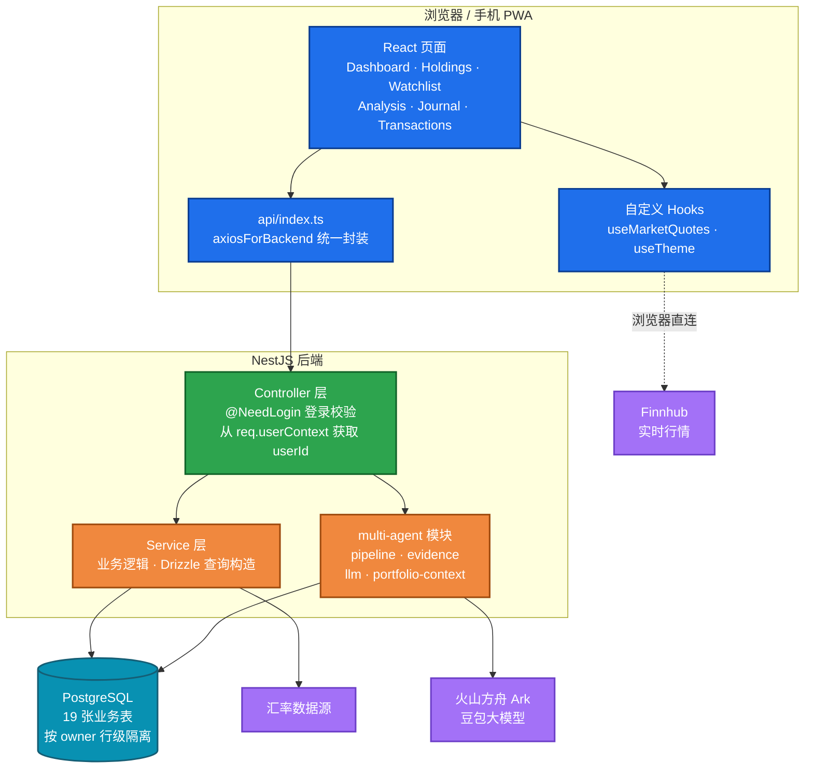
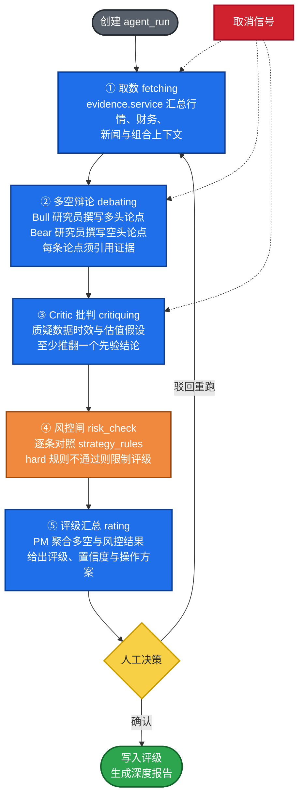

[English](README.md) | 简体中文

# Daily Portfolio Analysis（每日持仓分析）

Daily Portfolio Analysis 是一个全栈股票持仓管理终端。每个交易日收盘后，系统对全部持仓进行逐一体检，扫描关注列表中的交易机会，并记录当日净值快照与投资日志。针对单只股票，可运行多智能体深度分析，输出包含多空辩论与风控检查的深度研究报告。

系统采用前后端分离架构，所有业务数据存储于后端 PostgreSQL，并按账号行级隔离；在电脑或手机上登录同一账号即可访问同一份数据，历史评级、交易记录与深度报告均长期保留。

## 功能特性

- **仪表盘**：账户总值、市值、成本、累计与当日盈亏，支持按自定义分组汇总（如「Alpha Picks 定投」与「自主持仓」分开统计）。
- **持仓管理**：每只股票的评级、操作建议与目标价；桌面端表格视图，手机端卡片视图。
- **关注列表**：记录目标买入价与交易信号，每日扫描买卖机会。
- **每日分析**：每只持仓与关注股对应一张分析卡片，包含评级、操作、目标价、催化剂与风险。
- **多智能体深度报告**：包含 14 个板块的研究报告（核心论点、财务、SOTP 分部估值、多空辩论、Critic 批判、风控闸、PM 决策等）；每次运行均保留一个新版本并附带生成时间。
- **已实现盈亏**：交易记录页以 Robinhood 风格汇总 Realized P&L，按股票与币种统计，替代原已平仓列表。
- **策略规则**：风控规则（单一公司敞口上限、杠杆 ETF 上限、现金缓冲、止损线）可在页面上配置，并在分析时作为硬性闸门。
- **投资日志与快照**：自动生成五段式投资日志，净值曲线基于每日快照。
- **多币种**：USD / HKD / CNY 分账核算，并按汇率折算汇总。
- 支持深色模式、移动端安全区适配，并可「添加到主屏幕」作为 PWA 使用。

## 项目架构

### 总体架构

前端为 React SPA，后端为 NestJS，数据库为 PostgreSQL。行情数据由浏览器直接向 Finnhub 请求，API Token 仅存储于本地设备；多智能体分析中的推理由后端调用火山方舟（豆包）大模型完成；汇率数据由后端 FX 模块统一获取。



### 请求链路

所有后端接口遵循统一的分层设计，以持仓接口为例：

- Controller 层通过 `@NeedLogin()` 拦截未登录请求；userId 从 `req.userContext` 获取，不接受前端传入。
- Service 层通过注入的 `DRIZZLE_DATABASE` 句柄访问数据库，所有查询均包含 `owner = userId` 条件，防止越权访问。

```mermaid
flowchart LR
    Page["页面组件<br/>如 HoldingsPage"]:::fe
    Api["api/index.ts<br/>axiosForBackend"]:::fe
    Ctrl["HoldingsController<br/>@NeedLogin()"]:::ctrl
    Svc["HoldingsService"]:::svc
    Drizzle["Drizzle ORM"]:::drv
    PG[("holdings 表")]:::db

    Page -->|"fetchHoldings()"| Api
    Api -->|"GET /api/portfolio/holdings"| Ctrl
    Ctrl -->|"req.userContext.userId"| Svc
    Svc -->|"db.select()...<br/>where(owner = userId)"| Drizzle
    Drizzle --> PG
    PG -->|"rows"| Svc
    Svc -->|"mapRow → ListResponse"| Page

    classDef fe fill:#1f6feb,stroke:#0b3d91,color:#ffffff,stroke-width:2px
    classDef ctrl fill:#2da44e,stroke:#116329,color:#ffffff,stroke-width:2px
    classDef svc fill:#f0883e,stroke:#9e4b0f,color:#ffffff,stroke-width:2px
    classDef drv fill:#bf5af2,stroke:#8957e5,color:#ffffff,stroke-width:2px
    classDef db fill:#0891b2,stroke:#155e75,color:#ffffff,stroke-width:2px
```

- 前后端共享的类型定义（如 `Holding`、`CreateHoldingDto`、`ListResponse<T>`）统一存放于 `shared/api.interface.ts`。



### 多智能体流水线

单只股票的深度分析由五个阶段组成。各阶段状态实时写回 `agent_runs`，前端可轮询展示进度，运行过程中支持随时取消。



深度报告共 14 个板块，由 `client/src/components/MultiAgent/DeepReportView.tsx` 渲染，数据通过 `GET /api/multi-agent/deep-report/:runId` 获取。

## 目录结构

```
.
├── client/                 # React 前端
│   └── src/
│       ├── pages/          # 各业务页面（按功能分目录）
│       ├── components/
│       │   ├── MultiAgent/ # 深度报告、运行卡片、评级徽章
│       │   ├── ui/         # 基础组件（shadcn 风格）
│       │   └── business-ui/# 业务选择器（人员 / 部门 / 会话）
│       ├── hooks/          # 行情轮询、主题、移动端判断
│       └── api/index.ts    # 后端接口的前端封装
├── server/                 # NestJS 后端
│   ├── database/schema.ts  # Drizzle 表结构（自动生成，勿手动修改）
│   ├── common/             # 异常过滤器、通用常量
│   └── modules/            # 业务模块（controller + service + module）
├── shared/
│   └── api.interface.ts    # 前后端共享类型
└── scripts/                # dev / build / lint 脚本
```

## 数据模型

数据库共 19 张表，分为三组：

| 分组 | 表 | 说明 |
|---|---|---|
| 日常业务 | `holdings`、`watchlist`、`transactions`、`closed`、`analysis`、`groups`、`journal`、`snapshots`、`alpha_picks`、`cash_accounts`、`fx_rates` | 持仓、关注、交易、每日分析、分组、日志、净值快照等 |
| 多智能体 | `agent_runs`、`agent_evidence`、`bull_bear_arguments`、`debate_records`、`agent_ratings`、`risk_gate_results`、`agent_audit_log`、`deep_report` | 分析运行的全过程数据及最终深度报告 |
| 配置 | `strategy_rules` | 风控规则，支持页面增删改与启停 |

表结构以 `server/database/schema.ts` 为准。该文件由平台工具根据数据库自动生成（`npm run gen:db-schema`），不应手动编辑。

## 本地开发

环境要求：Node.js >= 22、npm >= 10。Windows 环境下 dev/build 脚本为 shell 脚本，需通过 Git Bash 执行。

```bash
# 安装依赖
npm install

# 复制环境变量模板并按需填写
cp .env.example .env
#   未填写 DOUBAO_API_KEY 时应用可正常运行，仅多智能体的 LLM 推理不可用
#   使用自建 PostgreSQL 时需设置 DATABASE_URL

# 同时启动后端（NestJS）与前端（Vite）
npm run dev

# 也可分别启动
npm run dev:server   # http://localhost:3000
npm run dev:client   # http://localhost:8080
```

`npm run dev` 执行 `scripts/dev.js`，统一管理前后端进程：进程异常退出时自动重启，短时间内反复崩溃则采用指数退避；日志按进程分别写入 `logs/`；退出时按进程组清理并释放占用端口。

生产构建与启动：

```bash
npm run build
npm start
```

## 配置说明

- **Finnhub Token**：不入库、不经过服务端。在页面界面中配置后存储于当前设备浏览器的 `localStorage`，更换设备需重新配置。
- **豆包 LLM**：在 `.env` 中设置 `DOUBAO_API_KEY`，模型与 base URL 均可通过环境变量覆盖，详见 `.env.example`。
- **平台依赖**：项目依赖 `@lark-apaas/*` 系列包完成托管、登录与数据库注入。若需完全脱离平台独立部署，需将登录、数据库连接与构建配置替换为自有实现，业务模块代码可原样保留。

## 免责声明

本项目仅用于个人记录与学习交流，不构成任何投资建议，据此操作产生的盈亏由使用者自行承担。

## 许可证

[MIT](LICENSE)
