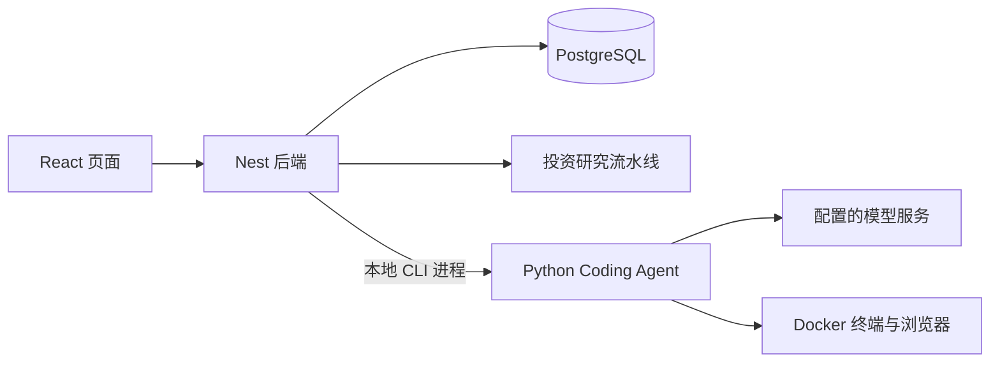

[English](README.md) | 简体中文

# Daily Portfolio Analysis

这个仓库包含投资组合管理应用，以及在 `/dev` 中操作项目源码的本地 Coding Agent。

## 先分清三个部分

| 部分 | 入口 | 职责 |
| --- | --- | --- |
| React 前端 | `client/src/app.tsx` | 持仓、交易、研究报告和 `/dev` 对话界面 |
| NestJS 后端 | `server/app.module.ts` | 登录上下文、数据库、投资分析、启动本地 Agent 进程 |
| Python Agent | `agent/src/agent_core/cli.py` | Coding Agent 循环、模型调用、容器工具、检查点；另提供行情客户端与评测命令 |

业务数据库只由后端访问。投资研究流水线在 `server/modules/multi-agent/`；开发项目的 Coding Agent 在 `agent/src/agent_core/coder/`。它们承担不同任务。



## 从哪里读代码

| 想了解什么 | 阅读顺序 |
| --- | --- |
| 普通业务请求 | `client/src/pages/` → `client/src/api/index.ts` → `server/modules/` → `shared/api.interface.ts` |
| `/dev` 提交任务 | `DevTaskComposer.tsx` → `client/src/api/dev-agent.ts` → `server/modules/dev-agent/` |
| Coding Agent 如何执行 | `coder/cli.py` → `general_harness.py` → `react_loop.py` → `general_tools.py` / `extensions.py` |
| 模型与外部工具 | `agent/src/agent_core/models/`、`coder/integrations/` |
| 沙箱、回滚与并行 | `coder/runtime/`、`coder/checkpoints/`、`coder/workers.py` |

当前新任务使用 v2 `GeneralHarness`。`harness.py` 是仍被存量 v1 任务使用的兼容执行器，阅读新流程时先看 `general_harness.py`。详细说明见 [Python Agent](agent/README.md)。

## 本地启动

需要 Node.js 22+、npm 10+、Python 3.11+ 和 uv。Coding Agent 执行工具还需要 Docker；已有依赖与配置时直接启动即可。

```powershell
npm install
Set-Location agent
uv sync
Set-Location ..
npm run dev:local
```

前端默认 `http://localhost:8080`，后端默认 `http://localhost:3000`；Coding Agent 页面为 `/dev`。`dev:local` 会检查已有开发进程，避免同一项目启动第二套服务。

配置分两处：

- 根目录 `.env.local`：后端、数据库、本地身份；参考 [.env.local.example](.env.local.example)。启用开发控制台需 `AGENT_DEV_ENABLED=true`。
- `agent/.env`：编码/视觉模型、MCP 与容器设置；参考 [agent/.env.example](agent/.env.example)。已有配置不要用模板覆盖。

业务页面需要可用 PostgreSQL 与匹配的用户身份。新环境的数据库准备见 [快照说明](db/snapshot/README.md)；开发、数据库、平台同步与构建入口统一见 [scripts/README.md](scripts/README.md)。

Windows + WSL Ubuntu 的 Coding Agent 镜像准备命令：

```powershell
powershell -ExecutionPolicy Bypass -File scripts/coder-runtime/prepare.ps1
```

`npm run dev` 通过平台维护的 `scripts/dev.sh` 选择沙箱或本地启动器；本仓库日常本地开发优先使用 `npm run dev:local`。

## Coding Agent 的执行边界

Agent 在独立源码副本与容器中执行，支持终端、浏览器、受控联网、MCP、Skills 和隔离子任务。每笔源码修改保留检查点；目标与回归验证绑定当前源码版本。候选通过后等待用户审阅，批准时隔离复验并应用到主目录。

默认没有任务总迭代次数或总时长截止。单命令超时、资源限制、外部写操作审批仍存在。模型、视觉与 MCP 能力取决于实际配置，可在 `/dev` 右上角设置中查看“模型”“MCP 服务”和“运行能力”。

业务 Web 与 Coding Agent 的部署条件不同；完整 Agent 目前运行在本地。发布妙搭前请阅读[部署边界与远程执行服务方案](agent/DEPLOYMENT.md)。

## 验证与产物

```powershell
npm run type:check
npm run test:unit
npx playwright test -c playwright.runtime.config.ts
Set-Location agent
uv run python -m pytest -q
```

浏览器 runtime 用例复用已有本地服务并模拟 API；`npm run test:e2e:fullstack` 使用独立端口和假 Agent。真实 Docker 用例需要另外启用集成测试标志，真实模型评测另见 `scripts/evaluate-coding-agent.py`。

| 目录 | 内容 | Git 状态 |
| --- | --- | --- |
| `client/`、`server/`、`shared/`、`agent/src/` | 应用源码与契约 | 版本管理 |
| `scripts/`、`e2e/`、`agent/tests/` | 运行入口与验证 | 版本管理 |
| `agent/data/` | 任务历史、对话、检查点 | 运行数据按规则忽略 |
| `output/`、`logs/`、`backups/` | 截图、评测证据、日志与备份 | 本地保留，忽略 |
| `docs/` | 本地审计、设计和深入学习资料 | 按项目约定忽略 |

本地资料导航见 `docs/README.md`。共享项目说明以本文件、`agent/README.md` 和 `scripts/README.md` 为入口。

MIT License。投资相关功能用于记录与学习，不构成投资建议。
