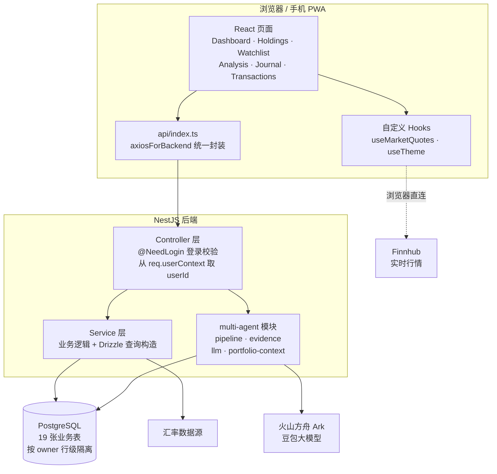
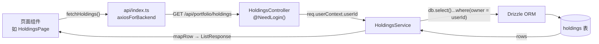
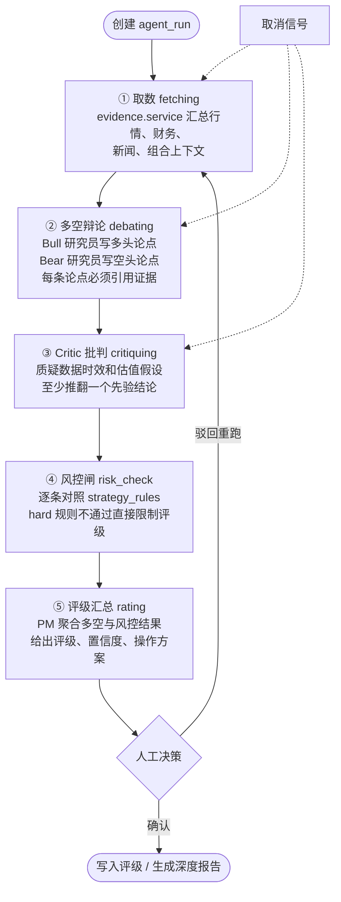

[English](README.md) | 简体中文

# Daily Portfolio Analysis（每日持仓分析）

一个给自己用的股票持仓管理终端。每个交易日收盘后，它会把持仓逐个体检一遍，
扫一遍关注列表里的机会，再把当天的净值和投资日志记下来；如果想深入研究某只股票，
还可以跑一次多智能体深度分析，产出一份带多空辩论和风控检查的深度报告。

它不是一个只做展示的看板——所有数据都在后端 PostgreSQL 里，按账号隔离，
电脑和手机登录同一个账号看到的是同一份数据，历史评级、交易记录和深度报告都会长期保留。

## 为什么会有这个项目

最初只是想解决一个很具体的问题：每天收盘后，手动翻持仓、查新闻、判断要不要
止盈止损太费时间，而且决策全凭感觉，事后也没法复盘。于是把每天的分析流程固化成
一套固定的流水线：取数 → 多空双方各自立论 → 互相挑错 → 过风控规则 → 汇总评级。
评级对了还是错了、盈亏来自哪里，都可以从历史记录里翻出来对照，规则也随之迭代。

## 功能一览

- **仪表盘**：账户总值、市值、成本、累计/当日盈亏，支持按自定义分组汇总
  （比如「Alpha Picks 定投」和「自主持仓」分开统计）。
- **持仓管理**：每只股票的评级、操作建议、目标价；桌面端表格、手机端卡片。
- **关注列表**：记录目标买入价和信号，每天扫描是否出现买卖机会。
- **每日分析**：每只持仓/关注股一张分析卡片，包含评级、操作、目标价、催化剂、风险。
- **多智能体深度报告**：14 个板块的研究报告（核心论点、财务、SOTP 分部估值、
  多空辩论、Critic 批判、风控闸、PM 决策……）。每次运行都保留一个新版本，附生成时间。
- **已实现盈亏**：交易记录页按 Robinhood 的方式汇总 Realized P&L，按股票和币种统计，
  替代了原来的已平仓列表。
- **策略规则**：风控规则（单一公司敞口上限、杠杆 ETF 上限、现金缓冲、止损线）可在页面上配置，
  分析时作为硬性闸门。
- **投资日志与快照**：自动生成五段式日志，净值曲线来自每日快照。
- **多币种**：USD / HKD / CNY 分账核算，再按汇率折算汇总。
- 深色模式、手机安全区适配，可以「添加到主屏幕」当 App 用。

## 项目架构

### 总体架构

前后端分离，前端是 React SPA，后端是 NestJS，数据库 PostgreSQL。
行情数据在浏览器端直接向 Finnhub 拉取（token 只存在本地设备上）；
多智能体分析中的推理由后端调用火山方舟（豆包）大模型完成；汇率走后端的 FX 模块。



### 一次请求的链路

所有后端接口都遵循同一套分层，以持仓接口为例：



几个关键点：

- Controller 上的 `@NeedLogin()` 保证未登录访问直接被拦，userId 不相信前端传入，
  一律从 `req.userContext` 取。
- Service 通过注入的 `DRIZZLE_DATABASE` 句柄操作数据库，所有查询都带
  `owner = userId` 条件，避免越权读到别人的数据。
- 前后端共用的类型（`Holding`、`CreateHoldingDto`、`ListResponse<T>` 等）放在
  `shared/api.interface.ts`，后端直接引用，避免两边类型对不上。

### 多智能体流水线

单只股票的深度分析是一条五阶段流水线，每个阶段结束都会把状态写回 `agent_runs`，
前端可以轮询状态展示进度条，也可以随时取消：



深度报告的 14 个板块对应 `client/src/components/MultiAgent/DeepReportView.tsx` 里的渲染结构，
数据从 `GET /api/multi-agent/deep-report/:runId` 拉取。

## 目录结构

```
.
├── client/                 # React 前端
│   └── src/
│       ├── pages/          # 各业务页面（按功能分目录）
│       ├── components/
│       │   ├── MultiAgent/ # 深度报告、运行卡片、评级徽章
│       │   ├── ui/         # 基础组件（shadcn 风格）
│       │   └── business-ui/# 业务选择器（人员/部门/会话）
│       ├── hooks/          # 行情轮询、主题、移动端判断
│       └── api/index.ts    # 后端接口的前端封装
├── server/                 # NestJS 后端
│   ├── database/schema.ts  # Drizzle 表结构（自动生成，勿手改）
│   ├── common/             # 异常过滤器、通用常量
│   └── modules/            # 业务模块，每个模块三件套
│                         #   controller + service + module
├── shared/
│   └── api.interface.ts    # 前后端共享类型
└── scripts/                # dev/build/lint 脚本
```

## 数据模型

数据库一共 19 张表，大致分三组：

| 分组 | 表 | 说明 |
|---|---|---|
| 日常业务 | `holdings`、`watchlist`、`transactions`、`closed`、`analysis`、`groups`、`journal`、`snapshots`、`alpha_picks`、`cash_accounts`、`fx_rates` | 持仓、关注、交易、每日分析、分组、日志、净值快照等 |
| 多智能体 | `agent_runs`、`agent_evidence`、`bull_bear_arguments`、`debate_records`、`agent_ratings`、`risk_gate_results`、`agent_audit_log`、`deep_report` | 一次分析运行的全过程数据和最终深度报告 |
| 配置 | `strategy_rules` | 风控规则，可在页面上增删改、启停 |

表结构以 `server/database/schema.ts` 为准——这个文件是由平台工具根据数据库
自动生成的（`npm run gen:db-schema`），不要手动编辑。

## 本地开发

需要 Node.js >= 22、npm >= 10。Windows 上注意 dev/build 用的是 shell 脚本，
要装 Git Bash 并在能执行 `.sh` 的环境里跑。

```bash
# 安装依赖
npm install

# 复制环境变量模板，按需填写
cp .env.example .env
#   DOUBAO_API_KEY 不填也能跑，只是多智能体的 LLM 推理不可用
#   用自己的 PostgreSQL 时再设置 DATABASE_URL

# 同时启动后端（NestJS）和前端（Vite）
npm run dev

# 也可以分开启动
npm run dev:server   # http://localhost:3000
npm run dev:client   # http://localhost:8080
```

`npm run dev` 实际执行的是 `scripts/dev.js`，它会把前后端两个进程管起来：
进程异常退出会自动重启（短时间内反复崩会指数退避，避免空转），
日志按进程分文件写到 `logs/` 目录，Ctrl+C 时按进程组清理，
顺手把占用端口的残留进程也杀掉——这些都是之前开发时被孤儿进程和 stale dist
坑过之后补上的。

生产构建：

```bash
npm run build
npm start
```

## 配置说明

- **Finnhub token**：不入库、不进服务端。打开页面后在界面上配置，存在当前设备
  浏览器的 `localStorage`，换设备需要重新配一次。
- **豆包 LLM**：在 `.env` 里设置 `DOUBAO_API_KEY`，模型和 base URL 也都可以通过
  环境变量覆盖，见 `.env.example`。
- **平台依赖**：项目依赖 `@lark-apaas/*` 系列包完成托管、登录和数据库注入。
  如果要完全脱离平台独立部署，需要把登录、数据库连接、构建配置这几处替换成自己的实现，
  业务模块本身的代码可以原样保留。

## 免责声明

代码仅用于个人记录和学习交流，不构成任何投资建议，据此操作的盈亏自负。

## 许可证

[MIT](LICENSE)
