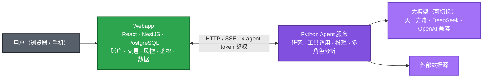
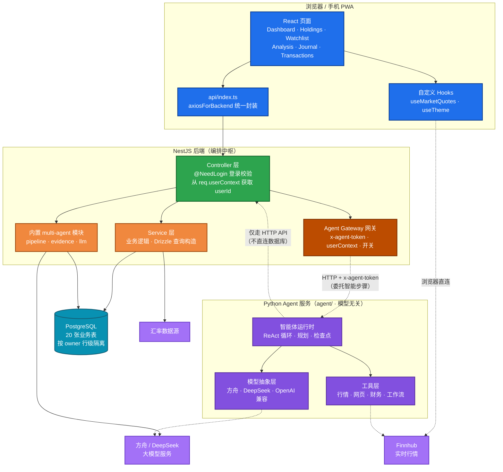

[English](README.md) | 简体中文

# Daily Portfolio Analysis（每日持仓分析）

**自托管的投资组合终端：一支 AI 分析师团队——多头、空头、批评者、风控闸、基金经理——为你的持仓辩论，并输出 14 节深度研报。**

[](LICENSE)
[](https://nodejs.org/)
[](https://react.dev/)
[](https://nestjs.com/)
[](https://www.postgresql.org/)
[](docker-compose.yml)
[](CONTRIBUTING.md)


<details>
<summary><b>更多截图</b>（每日分析 · 深度研报）</summary>


</details>

## 与其他持仓管理工具不一样的地方

大多数持仓工具止步于「展示」数字，这个项目会为你的数字「吵架」。

对任意一只持仓或关注股，**五阶段多智能体流水线**会执行一套结构化研究流程：

| 阶段 | 发生什么 |
|---|---|
| ① 证据采集 | 汇总行情、财务、新闻与你的组合上下文，形成带引用的证据条目 |
| ② 多空辩论 | 多头研究员与空头研究员各写一份立场——**每条论点必须引用证据** |
| ③ Critic 批判 | 批评者向双方发难——且必须至少推翻一条既有论断 |
| ④ 风控闸 | 你配置的策略规则（单一公司上限、行业上限、现金缓冲、止损线…）作为**硬门**执行，违规则约束最终评级 |
| ⑤ PM 汇总 | PM 角色合并辩论与风控结果，输出评级、置信度、目标价与操作方案 |

产出是一份 **14 节深度研究报告**（核心论点、财务、SOTP 分部估值、多空论点、Critic 修正、催化剂时间线、风险矩阵、PM 决策等）。每次运行**保留版本**：重跑一只股票就能对比观点如何变化、以及**为什么**变——demo 数据里内置了一段 NVDA `Hold` → `Buy` 的上调记录，包括被推翻的空头论点原文。

持仓终端该有的也都在：每日逐持仓体检、关注列表买卖信号扫描、净值快照与投资日志、已实现盈亏、多币种分账（USD/HKD/CNY）、页面上可配置的风控规则。

## 快速开始（Docker，约 5 分钟，无需任何 API Key）

```bash
git clone https://github.com/Lueyu/daily-portfolio-analysis.git
cd daily-portfolio-analysis
docker compose up --build
```

打开 **http://localhost:3000**，会自动加载一个虚构的演示账户：

- 6 只持仓，覆盖美股 / 港股 / A 股三个市场，含评级、目标价与分析卡片
- 关注列表（买入/观望/回避信号）、交易记录、已实现盈亏、近 5 周净值曲线
- **3 次已完成的 Agent 运行，其中 NVDA 研报保留了两个版本**（Hold → Buy 上调，含完整辩论、Critic 与风控记录）——入口在 **每日分析 → 深度研报**
- 一条被触发的风控规则（半导体行业敞口 31% > 30% 上限），可以直观看到违例如何浮出水面

> Demo 不需要 Finnhub / 大模型 Key——行情回退到预置价格，预生成的研报自己会说话。Key 只在你开始对自己组合跑分析时才需要（见[配置说明](#配置说明)）。
>
> **网络受限？** 若 Docker Hub 不可达，先通过镜像源拉取基础镜像：`docker compose build --build-arg BASE_REGISTRY=docker.m.daocloud.io/library`，并在 `.env` 中设置 `DB_IMAGE=docker.m.daocloud.io/library/postgres:16-alpine` 后再 `docker compose up`。

## 功能特性

- **仪表盘**：账户总值、市值、成本、累计与当日盈亏，支持按自定义分组汇总（如「Alpha Picks 定投」与「自主持仓」分开统计）。
- **持仓管理**：每只股票的评级、操作建议与目标价；桌面端表格视图，手机端卡片视图。
- **关注列表**：记录目标买入价与交易信号，每日扫描买卖机会。
- **每日分析**：每只持仓与关注股对应一张分析卡片，包含评级、操作、目标价、催化剂与风险。
- **多智能体深度报告**：包含 14 个板块的研究报告（核心论点、财务、SOTP 分部估值、多空辩论、Critic 批判、风控闸、PM 决策等）；每次运行均保留一个新版本并附带生成时间。
- **独立 Python Agent 服务**：位于 `agent/`，模型层与厂商解耦（火山方舟 / DeepSeek / 任意 OpenAI 兼容接口），内置工具调用、规划、检查点与多智能体编排，运行过程可回放；它只通过后端 HTTP API 取数，不直连业务数据库。
- **已实现盈亏**：交易记录页以 Robinhood 风格汇总 Realized P&L，按股票与币种统计，替代原已平仓列表。
- **策略规则**：风控规则（单一公司敞口上限、杠杆 ETF 上限、现金缓冲、止损线）可在页面上配置，并在分析时作为硬性闸门。
- **投资日志与快照**：自动生成五段式投资日志，净值曲线基于每日快照。
- **多币种**：USD / HKD / CNY 分账核算，并按汇率折算汇总。
- 支持深色模式、移动端安全区适配，并可「添加到主屏幕」作为 PWA 使用。

## 项目架构

### 总体架构

系统由两部分组成：全栈交易终端（NestJS + React + PostgreSQL）作为账户、交易、评级与报告的权威落库层；`agent/` 下的独立 Python 智能体服务承担行情查询、研究与分析等推理任务。后端是唯一的业务编排者和数据出口，通过受保护的 HTTP 接口把推理任务委托给智能体；智能体与模型厂商解耦，可切换火山方舟、DeepSeek 或任意 OpenAI 兼容接口，且不直接访问业务数据库。

行情数据由浏览器直接向 Finnhub 请求，API Token 仅存储于本地设备；汇率数据由后端 FX 模块统一获取。

先看系统边界（总览）：



后端是唯一的系统记录层，Agent 只通过受控接口取数、产出分析，不直接读写数据库；下面展开各组件与数据流。



### 智能体推理：内置流水线与独立 Agent 服务

智能分析落在两个位置，分别对应已经在生产运行的业务流水线，和被独立出来的推理服务，职责并不重叠：

- **后端内置分析流水线（NestJS）**：当前每天运行的实现，是一条固定的五阶段流水线（取数 → 多空辩论 → Critic 批判 → 风控闸 → 评级汇总），由后端直接调用大模型，产出 14 个板块的深度报告。
- **独立 Python Agent 服务（`agent/`）**：把推理能力从业务后端中拆出的独立服务。它不依赖重量级 Agent 框架，工具调用、规划、检查点与多智能体编排都在本仓库内实现，便于调试与扩展；模型层与厂商解耦，可切换火山方舟、DeepSeek 或任意 OpenAI 兼容接口。

两者之间是清晰的服务边界。NestJS 负责登录、数据库、交易、权限和页面，是唯一写库的地方；Python Agent 不连接业务库，只通过 Agent Gateway（`x-agent-token` 鉴权、服务端注入用户身份）向后端取数，后端把需要推理的步骤委托给它。这样更换模型、调整推理逻辑或重写 Agent 都不会影响账户与数据，Agent 也可以独立开发和测试。

### 请求链路

所有后端接口遵循统一的分层设计，以持仓接口为例：

- Controller 层通过 `@NeedLogin()` 拦截未登录请求；userId 从 `req.userContext` 获取，不接受前端传入。
- Service 层通过注入的 `DRIZZLE_DATABASE` 句柄访问数据库，所有查询均包含 `owner = userId` 条件，防止越权访问。

```mermaid
flowchart LR
    Page["页面组件<br/>如 HoldingsPage"]:::fe
    Api["api/index.ts<br/>axiosForBackend"]:::fe
    Ctrl["HoldingsController<br/>@NeedLogin()"]:::ctrl
    Svc["HoldingsService"]:::svc
    Drizzle["Drizzle ORM"]:::drv
    PG[("holdings 表")]:::db

    Page -->|"fetchHoldings()"| Api
    Api -->|"GET /api/portfolio/holdings"| Ctrl
    Ctrl -->|"req.userContext.userId"| Svc
    Svc -->|"db.select()...<br/>where(owner = userId)"| Drizzle
    Drizzle --> PG
    PG -->|"rows"| Svc
    Svc -->|"mapRow → ListResponse"| Page

    classDef fe fill:#1f6feb,stroke:#0b3d91,color:#ffffff,stroke-width:2px
    classDef ctrl fill:#2da44e,stroke:#116329,color:#ffffff,stroke-width:2px
    classDef svc fill:#f0883e,stroke:#9e4b0f,color:#ffffff,stroke-width:2px
    classDef drv fill:#bf5af2,stroke:#8957e5,color:#ffffff,stroke-width:2px
    classDef db fill:#0891b2,stroke:#155e75,color:#ffffff,stroke-width:2px
```

- 前后端共享的类型定义（如 `Holding`、`CreateHoldingDto`、`ListResponse<T>`）统一存放于 `shared/api.interface.ts`。



### 多智能体流水线

单只股票的深度分析由五个阶段组成。各阶段状态实时写回 `agent_runs`，前端可轮询展示进度，运行过程中支持随时取消。


深度报告共 14 个板块，由 `client/src/components/MultiAgent/DeepReportView.tsx` 渲染，数据通过 `GET /api/multi-agent/deep-report/:runId` 获取。

## 目录结构

```
.
├── agent/                  # Python Agent 服务（模型无关，Typer/FastAPI）
│   ├── src/agent_core/     # 运行时、模型抽象、工具、webapp 客户端
│   ├── tests/              # pytest + pytest-httpx（不打真实网络）
│   ├── data/checkpoints/   # JSONL 检查点（运行时数据，git 中保留空目录）
│   └── pyproject.toml
├── client/                 # React 前端
│   └── src/
│       ├── pages/          # 各业务页面（按功能分目录）
│       ├── components/
│       │   ├── MultiAgent/ # 深度报告、运行卡片、评级徽章
│       │   ├── ui/         # 基础组件（shadcn 风格）
│       │   └── business-ui/# 业务选择器（人员 / 部门 / 会话）
│       ├── hooks/          # 行情轮询、主题、移动端判断
│       └── api/index.ts    # 后端接口的前端封装
├── server/                 # NestJS 后端（编排中枢）
│   ├── database/schema.ts  # Drizzle 表结构（自动生成，勿手动修改）
│   ├── common/
│   │   ├── middleware/     # 本地 dev 身份注入（LOCAL_DEV_USER_ID 门控）
│   │   └── filters/        # 全局异常过滤器
│   └── modules/            # 业务模块（controller + service + module）
├── shared/
│   └── api.interface.ts    # 前后端共享类型
├── scripts/
│   ├── db/                 # 建库/建表/角色 + demo 种子数据（docker compose 使用）
│   ├── dev-local-*.ps1     # Windows 本地一键启动（minimal / db / full / client）
│   └── sync-from-miaoda.ps1# 妙搭 -> GitHub 同步
├── db/
│   └── snapshot/           # 本地真实数据快照（*.sql 已 gitignore，仅本地）
├── drizzle/                # drizzle-kit 生成的建表 migration
├── Dockerfile              # 自托管镜像（build + runtime 双阶段）
└── docker-compose.yml      # PostgreSQL + 应用 + 虚构演示数据
```

## 数据模型

数据库共 20 张表，分为三组：

| 分组 | 表 | 说明 |
|---|---|---|
| 日常业务 | `holdings`、`watchlist`、`transactions`、`closed`、`analysis`、`groups`、`journal`、`snapshots`、`alpha_picks`、`cash_accounts`、`fx_rates` | 持仓、关注、交易、每日分析、分组、日志、净值快照等 |
| 多智能体 | `agent_runs`、`agent_evidence`、`bull_bear_arguments`、`debate_records`、`agent_ratings`、`risk_gate_results`、`agent_audit_log`、`deep_report` | 分析运行的全过程数据及最终深度报告 |
| 配置 | `strategy_rules` | 风控规则，支持页面增删改与启停 |

表结构以 `server/database/schema.ts` 为准。该文件由平台工具根据数据库自动生成（`npm run gen:db-schema`），不应手动编辑。

## 本地开发

环境要求：Node.js >= 22、npm >= 10（Windows 下 shell 脚本需经 Git Bash 运行）。按需选择模式：

| 模式 | 启动方式 | 数据库 | 登录态 | 适用场景 |
| --- | --- | --- | --- | --- |
| **Docker 演示（推荐）** | `docker compose up --build` | 容器化 PostgreSQL + 演示数据 | 注入 demo 用户 | 约 5 分钟体验完整产品，无需任何 Key |
| 官方云端模式 | `npm run dev` | 妙搭托管 PostgreSQL | 需要 `lark-cli` + 账号登录 | 与线上完全一致的完整环境 |
| 最小离线模式 | `scripts/dev-local-minimal.ps1` | 不连库（跳过） | 无 | 只调公开行情端点（Agent 开发早期） |
| 全栈离线模式 | `scripts/dev-local-full.ps1` | 本地 PostgreSQL + 真实数据快照 | 本地注入固定用户 | 完整页面、完整数据，做 Agent 开发与演示 |

### Docker 演示模式细节

`docker compose up --build` 启动两个容器：

- **db**——PostgreSQL 16。首次启动时，initdb 按顺序执行 `scripts/db/01_init.sql`（schema 与复合类型）、`02_tables.sql`（20 张表）、`03_roles.sql`（datapaas 三角色）、`04_demo_seed.sql`（虚构演示数据）。数据持久化在 `dpa-data` 卷中；`docker compose down -v` 可完全重置。
- **app**——NestJS 服务，同时在 3000 端口提供 API 与构建后的 SPA。它以与离线开发模式相同的 `SUDA_DATABASE_URL` 配方连接 db 服务，本地开发中间件注入 `demo-user` 身份，登录守卫与 owner 行级隔离的行为与云端完全一致。

若要对真实股票跑分析，把你的 Key 加进 app 容器环境（例如写一个 `docker-compose.override.yml`）：内置流水线用 `DOUBAO_API_KEY`，实时行情用 Finnhub Token（在页面中配置）。详见[配置说明](#配置说明)。

### 官方云端模式

```bash
# 安装依赖
npm install

# 复制环境变量模板并按需填写
cp .env.example .env
#   未填写 DOUBAO_API_KEY 时应用可正常运行，仅多智能体的 LLM 推理不可用

# 同时启动后端（NestJS）与前端（Vite）；需要 lark-cli 拉取云端环境变量
npm run dev

# 也可分别启动
npm run dev:server   # http://localhost:3000
npm run dev:client   # http://localhost:8080
```

`npm run dev` 执行 `scripts/dev.js`，统一管理前后端进程：进程异常退出时自动重启，短时间内反复崩溃则采用指数退避；日志按进程分别写入 `logs/`；退出时按进程组清理并释放占用端口。

生产构建：

```bash
npm run build:prod   # nest build + vite build
```

### 全栈离线模式：本地 PostgreSQL + 真实数据

该模式在本机完整复刻平台运行时，**无需登录、无需联网到妙搭**，就能看到自己的真实持仓，适合离线开发 Agent 与面试演示。它做了四件事：

1. **建表**：用 drizzle-kit 从 `server/database/schema.ts` 生成 DDL，建在独立的 `workspace_*` schema 下（`scripts/db/02_tables.sql`）。
2. **角色**：模拟平台 datapaas 每个请求 `SET LOCAL ROLE` 的三个数据库角色 `service_role_/authenticated_/anon_<schema>`（`scripts/db/03_roles.sql`）。
3. **数据**：把从妙搭导出的真实数据快照（`db/snapshot/*.sql`，**含个人数据，已 gitignore，不入库**）导入本地库。
4. **身份**：后端通过 `SUDA_DATABASE_URL` 连本地库；一个仅在 `LOCAL_DEV_USER_ID` 设置时生效的本地中间件（`server/common/middleware/local-dev-auth.middleware.ts`）注入网关用户头，于是 `@NeedLogin()` 守卫放行、SQL 上下文设置 `app.user_id`、`owner` 行级隔离与云端完全一致。

一次性准备：

```powershell
# 1) 安装 PostgreSQL（scoop 用户级安装，无需管理员）
scoop install postgresql

# 2) 把从妙搭导出的 7 个 *.sql 放入 db/snapshot/（详见 db/snapshot/README.md）

# 3) 一键建库 → 建表/角色 → 导入快照（幂等，可重复执行）
powershell -ExecutionPolicy Bypass -File scripts\db\rebuild-local.ps1
```

每次启动：

```powershell
# 启动本地 PostgreSQL（若未运行）+ 后端（连本地库）+ 前端
powershell -ExecutionPolicy Bypass -File scripts\dev-local-full.ps1
# 然后打开 http://127.0.0.1:8080
```

`LOCAL_DEV_USER_ID` 默认取快照里的属主用户 ID，只展示该账号的数据（例如同一快照里属于另一账号的持仓会被 `owner` 条件正确过滤掉）；要切换成其他账号，在启动前设置该环境变量即可。该中间件在不设置 `LOCAL_DEV_USER_ID` 时完全不生效，也不会覆盖真实网关头，因此对线上零影响。

### Python 智能体（`agent/`）

智能体使用 Python 3.12 与 [uv](https://docs.astral.sh/uv/)。

```bash
cd agent
uv sync                       # 创建 .venv 并安装依赖
cp .env.example .env          # 填入 ARK_API_KEY / DEEPSEEK_API_KEY
uv run agent health           # 检查 webapp 客户端
uv run agent quote AAPL       # 经 webapp 拉取真实行情
uv run pytest -q              # 运行离线测试
```

智能体通过 HTTP 与 Webapp 通信（`agent/.env` 中的 `WEBAPP_BASE_URL`），不需要独立的数据库连接。

## 妙搭云端 <-> GitHub 同步

Webapp 主要在妙搭（aPaaS）云端用 AI 开发，云端是 NestJS/React 代码的权威源头，而妙搭不是 git 仓库。可用一键同步脚本保持 GitHub 同步——它通过 `lark-cli` 导出云端最后一次提交的快照，只覆盖属于云端的路径，然后提交并推送：

```powershell
powershell -ExecutionPolicy Bypass -File scripts\sync-from-miaoda.ps1 -DryRun   # 仅预演
powershell -ExecutionPolicy Bypass -File scripts\sync-from-miaoda.ps1           # 同步 + 提交 + 推送
```

脚本会镜像 `client/`、`server/`、`shared/`、`.githooks/`、`.spark/` 及根配置文件，但绝不触碰 `agent/`、`docs/`、`README*`、`.gitignore`、`.env`、`*.sql`；覆盖前会先自动提交一个本地安全快照（本地改动不丢失），并在同步后重新应用仓库的跨环境补丁（`scripts/apply-local-patches.js`）。云端沙箱里未提交的改动不会被导出，请先在妙搭里提交/发布。

## 配置说明

- **Finnhub Token**：不入库、不经过服务端。在页面界面中配置后存储于当前设备浏览器的 `localStorage`，更换设备需重新配置。
- **豆包 LLM**：在 `.env` 中设置 `DOUBAO_API_KEY`，模型与 base URL 均可通过环境变量覆盖，详见 `.env.example`。
- **平台依赖**：Webapp 在妙搭（aPaaS）平台上开发，依赖 `@lark-apaas/*` 系列包完成托管、登录与数据库注入。Docker / 自托管路径用本地开发身份中间件替代平台网关，同一份业务代码即可独立运行；自部署时所需的环境变量见 docker-compose.yml。

## 参与贡献

欢迎 Issue 与 PR——见 [CONTRIBUTING.md](CONTRIBUTING.md)。带 `good first issue` 标签的是新手友好的切入点。

## 免责声明

本项目仅用于个人记录与学习交流，不构成任何投资建议，据此操作产生的盈亏由使用者自行承担。

## 许可证

[MIT](LICENSE)
