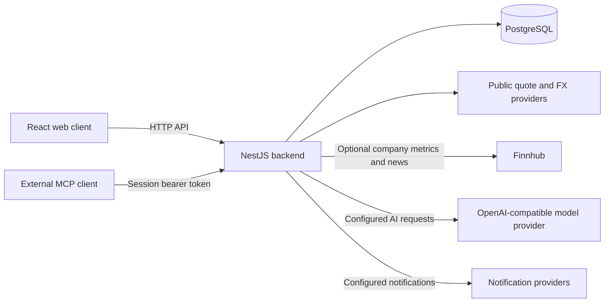

# Architecture

Squabble's working application is a React web client, a NestJS backend and
PostgreSQL. The backend runs the built-in analysis pipeline, portfolio APIs,
paper trading and notifications. Python is not required to run the web app or
generate its reports.

For setup, see [self-hosting](self-hosting.md). For the product overview, see
the [README](../README.md).

## Components and data flow

- **Client:** React, TypeScript, Vite, React Query and shared API types. The
  responsive web UI provides portfolios, analysis, imports, paper trading,
  Agent Builder and settings. It supports Chinese/English and four visual
  themes. There is currently no PWA manifest/service worker or native desktop
  installer in this repository.
- **Backend:** NestJS modules own the API and business logic. The web client
  calls the deployment's API; quote fetching is performed by the backend,
  rather than by a browser-held Finnhub token.
- **Database:** `postgres.js` and Drizzle connect directly through
  `server/common/platform/database.provider.ts`. The `platform` directory is
  the local compatibility layer, not a dependency on a hosted aPaaS runtime.
- **External data:** the quote module uses public Tencent, Sina and Yahoo
  endpoints as implemented for each market. The market-overview module fetches
  index data; the FX module fetches and stores exchange rates. Provider
  coverage, availability and freshness vary.

The local Docker setup runs the app and PostgreSQL. The production build
serves the client through NestJS; development runs the Vite client and NestJS
server separately.

## Accounts, ownership and credentials

First-party accounts use username/password authentication, bcrypt password
hashes, JWT bearer sessions and offline recovery codes. Protected controllers
obtain the authenticated user from `req.userContext`; business services scope
user data by owner. This is application-level ownership filtering, not a claim
that PostgreSQL row-level security policies enforce every query.

Per-user LLM and Finnhub credentials are encrypted in `user_api_settings`.
The settings API returns configuration and key status, not saved plaintext
keys. A user's saved model configuration takes precedence over the host's
optional `DOUBAO_API_KEY`. Without either, built-in analysis uses basic mode.
A configured provider failure is reported as an error; it does not silently
switch to basic mode.

Screenshot OCR has a separate configuration path: its key and image are sent
with the extraction request and forwarded by the backend to the selected
vision provider. This differs from the saved integration settings. See
[privacy](privacy.md) for storage and outbound-request details.

## Built-in analysis

The production analysis implementation is in `server/modules/multi-agent/`.
`BatchService` resolves holdings, watchlist entries or custom ticker symbols,
creates runs, and schedules them with separate concurrency limits for full
and summary modes. The client polls persisted status and can cancel a run.
In-memory queue entries do not survive a restart; interrupted runs are marked
failed with a retry message on startup.

The pipeline performs these steps:

1. **Collect and persist evidence.** Public quotes and the user's portfolio
   context are available without a model key. Optional Finnhub credentials
   add supported US-company metrics and news. Missing inputs are persisted
   explicitly as `Data Unavailable` records.
2. **Debate and critique, when a model is configured.** Bull and bear calls
   receive saved evidence, followed by a critic. Citation checks remove
   nonexistent evidence references and arguments with no valid reference.
   These checks establish a link to stored evidence; they do not establish
   that a model's interpretation of it is correct.
3. **Run local risk checks.** Portfolio context converts currencies for
   exposure calculations. Rules that cannot be verified are recorded as
   such. A failed hard rule prevents a Buy/Strong Buy final rating.
4. **Aggregate and save.** Basic mode skips model debate and returns
   `Watch/low` without a target price. Model mode combines the published
   arguments, critique and risk results, then applies deterministic limits.
   Critical evidence gaps force `Watch/low` and remove the target price.
5. **Present the report for human review.** The report stores the available
   outputs, evidence, risk results and a readable execution trace. The run
   reaches `awaiting_human`; the user can review the result and choose the
   supported synchronization actions.

**Current data limit:** a configured Finnhub key enables reported financial
statement fields, valuation metrics and recent news for supported US stocks.
Statement evidence keeps report periods, currencies and SEC filing references;
missing fields, stale reports and provider errors remain explicit gaps.
Historical technical series are not collected. Critical gaps still force
`Watch/low`; a successful API connection alone does not establish complete
coverage. The seeded demo's Buy ratings and scenario targets are fictional
examples, not evidence of live forecast generation.

The report UI supports a richer 14-section structure, but hides sections
without data. `analysis-report.ts` builds live reports from persisted outputs;
it does not invent financial models or fill every section. Earlier runs
remain available for review.

## Agent Builder and paper trading

`server/modules/paper-trading/` owns a separate paper account, positions,
orders, fills and event history. It does not submit orders to a real broker.
The scheduler scans enabled accounts on its configured interval, subject to
the market-session clock.

Agent Builder stores versioned guard/scout/balanced profiles and permits one
active profile per user. Executable behavior comes from explicit symbol,
rating, price-trigger and risk rules. Price triggers can create a paper idea
without a research Buy rating; the reason identifies the investor's rule.
The guard template does not open new positions. A custom prompt requires a
configured model and can veto a candidate, but cannot change its side/size
or bypass the deterministic limits.

Builder scans require a recently fetched public quote and an open market,
and apply the configured order and daily-loss limits. Retrieval freshness
does not guarantee an exchange-live price; public quotes may be delayed.
Filled paper orders can
create proposal records and optional notifications. A user may skip a
proposal or manually record the time, quantity, price and fees of a trade
placed in their own broker. That record stays in the proposal comparison
ledger; it does not update portfolio holdings or transactions.

Notifications support Webhook, Bark, Server酱, SMTP and Telegram. Dispatch
failures are logged and do not undo a paper fill.

## External agents

Two separate integration paths exist:

| Path | Current implementation |
|---|---|
| `/mcp` | JSON-RPC HTTP endpoint for external MCP clients. Agent-session bearer tokens scope permissions, paper-order spending limits and approval mode. Tools expose paper portfolio data, quotes, reports, orders and holdings import. |
| `agent/` and `/openapi/agent-gateway/holdings` | Optional Python CLI scaffold with `init`, `health`, `quote`, `holdings` and `modelping`, an HTTP client, model adapter and JSONL checkpoints. The gateway is disabled by default and authenticates a configured shared token plus allowed user identity. |

The Python package is not a running research orchestration service: this
repository does not yet implement the documented future ReAct loop, planning
or full tool layer there. NestJS does not delegate the built-in report
pipeline to Python.

## Source and database layout

| Path | Purpose |
|---|---|
| `client/src/pages/`, `components/`, `hooks/`, `api/` | Web UI, queries, quote polling and API calls |
| `server/modules/` | Auth, portfolio, analysis, market data, settings, imports, paper trading, notifications and MCP |
| `server/common/platform/` | Direct database connection, auth guard and local framework adapters |
| `server/database/schema.ts` | Drizzle table definitions used by application code |
| `shared/api.interface.ts` | Shared request/response and domain types |
| `scripts/db/` | Base schema, fictional demo data and additive schema updates |
| `agent/` | Optional Python CLI and its offline tests |
| `docker-compose.yml`, `deploy/` | Local demo and public deployment configuration |

The main data groups are portfolio records, analysis runs/evidence/reports,
strategy rules, accounts and sessions, paper-trading records, builder
profiles/proposals, notification channels, imports and encrypted integration
settings. The actual definitions are in `server/database/schema.ts`; avoid
using a fixed table count as an architectural contract.

Fresh databases need `scripts/db/01_schema.sql`. Demo data is in the separate
`02_demo_seed.sql`. The current database provider applies the additive
`03_agent_builder.sql` through `06_account_recovery.sql` files during startup;
that process does not create the base portfolio schema on an empty database.
Keep the SQL and Drizzle definitions aligned. There is currently no
`gen:db-schema` npm command in this repository.
