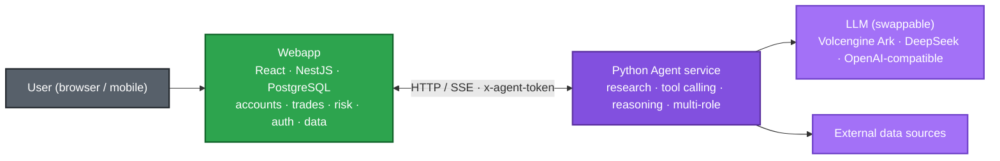
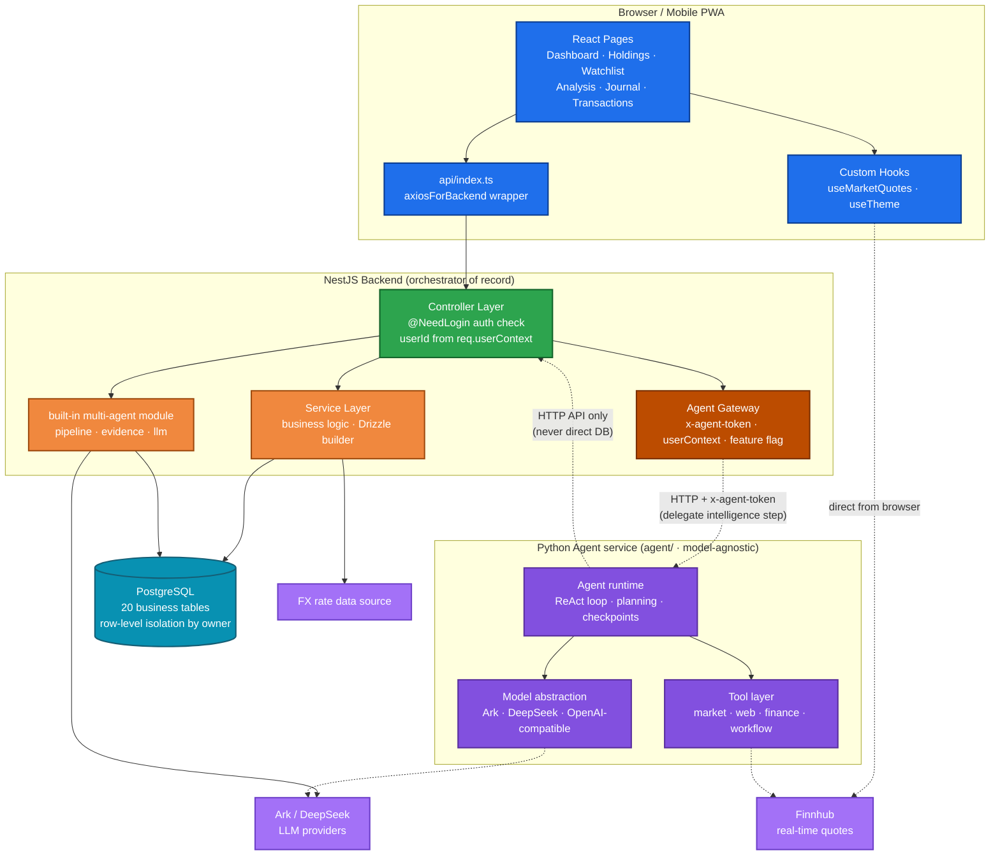
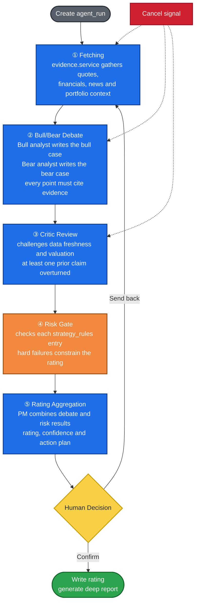

# Architecture

This document holds the technical details behind 吵股 Squabble: system boundary,
components, request flow, the multi-agent analysis pipeline, project layout and
data model. For the product overview see the [README](../README.md); 中文版见
[README.zh-CN.md](../README.zh-CN.md).

## Overall Architecture

The system has two parts: a full-stack trading terminal (NestJS + React + PostgreSQL) that is the system of record for accounts, transactions, ratings and reports, and a standalone Python agent service under `agent/` that handles reasoning tasks such as market queries, research and analysis. The backend is the sole orchestrator and data gateway, delegating reasoning to the agent over a protected HTTP API. The agent is model-agnostic — it can switch between Volcengine Ark, DeepSeek or any OpenAI-compatible endpoint — and never touches the business database directly.

Market data is requested directly from Finnhub in the browser, and the API token is stored only on the local device; FX rates are fetched centrally by the backend FX module.

The system boundary at a glance:



The backend is the only system of record; the agent fetches data and produces analysis through controlled interfaces and never reads or writes the database directly. The detailed components and data flows are below.



## Agent Reasoning: the Built-in Pipeline and the Standalone Service

Reasoning lives in two places: a production pipeline embedded in the backend, and a standalone service that factors that intelligence out. They have distinct responsibilities:

- **Built-in analysis pipeline (NestJS)** — the implementation running daily today: a fixed five-stage pipeline (fetch → bull/bear debate → critic → risk gate → rating) that calls the LLM directly from the backend and produces the 14-section deep reports.
- **Standalone Python Agent service (`agent/`)** — a separate service that takes reasoning out of the business backend. It relies on no heavyweight agent framework; tool calling, planning, checkpoints and multi-agent orchestration are implemented in this repository so they are easy to debug and extend. The model layer is provider-agnostic and can switch between Volcengine Ark, DeepSeek or any OpenAI-compatible endpoint.

The boundary between them is deliberate. NestJS owns auth, the database, transactions, permissions and the UI, and is the only component that writes to the database. The Python agent never connects to the business database; it reads data from the backend through an Agent Gateway secured by `x-agent-token` (with the user identity injected server-side), and the backend delegates only the reasoning steps. Swapping models, changing reasoning logic or rewriting the agent therefore never affects accounts or data, and the agent can be developed and tested independently.

## Request Flow

All backend endpoints follow a uniform layered design, illustrated by the holdings API:

- The controller layer rejects anonymous requests via `@NeedLogin()`; userId is obtained from `req.userContext` and never accepted from client input.
- The service layer accesses the database through the injected `DRIZZLE_DATABASE` handle; every query includes the `owner = userId` condition to prevent cross-account access.

```mermaid
flowchart LR
    Page["Page component<br/>e.g. HoldingsPage"]:::fe
    Api["api/index.ts<br/>axiosForBackend"]:::fe
    Ctrl["HoldingsController<br/>@NeedLogin()"]:::ctrl
    Svc["HoldingsService"]:::svc
    Drizzle["Drizzle ORM"]:::drv
    PG[("holdings table")]:::db

    Page -->|"fetchHoldings()"| Api
    Api -->|"GET /api/portfolio/holdings"| Ctrl
    Ctrl -->|"req.userContext.userId"| Svc
    Svc -->|"db.select()...<br/>where(owner = userId)"| Drizzle
    Drizzle --> PG
    PG -->|"rows"| Svc
    Svc -->|"mapRow → ListResponse"| Page

    classDef fe fill:#1f6feb,stroke:#0b3d91,color:#ffffff,stroke-width:2px
    classDef ctrl fill:#2da44e,stroke:#116329,color:#ffffff,stroke-width:2px
    classDef svc fill:#f0883e,stroke:#9e4b0f,color:#ffffff,stroke-width:2px
    classDef drv fill:#bf5af2,stroke:#8957e5,color:#ffffff,stroke-width:2px
    classDef db fill:#0891b2,stroke:#155e75,color:#ffffff,stroke-width:2px
```

- Types shared between front-end and backend (e.g. `Holding`, `CreateHoldingDto`, `ListResponse<T>`) are defined centrally in `shared/api.interface.ts`.



## Multi-Agent Pipeline

A deep analysis of one stock consists of five stages. Each stage writes its status back to `agent_runs`, allowing the front-end to poll and display progress, and the run can be cancelled at any time.



The deep report contains 14 sections rendered by `client/src/components/MultiAgent/DeepReportView.tsx`; data is fetched via `GET /api/multi-agent/deep-report/:runId`.

## Project Structure

```
.
├── agent/                  # Python Agent service (model-agnostic, Typer/FastAPI)
│   ├── src/agent_core/     # runtime, model abstraction, tools, webapp client
│   ├── tests/              # pytest + pytest-httpx (no live network)
│   ├── data/checkpoints/   # JSONL checkpoints (runtime; kept empty in git)
│   └── pyproject.toml
├── client/                 # React front-end
│   └── src/
│       ├── pages/          # business pages (grouped by feature)
│       ├── components/
│       │   ├── MultiAgent/ # deep reports, run cards, rating badges
│       │   ├── ui/         # base components (shadcn style)
│       │   └── business-ui/# business selectors (users / departments / chats)
│       ├── hooks/          # quote polling, theme, mobile detection
│       └── api/index.ts    # front-end wrappers for backend endpoints
├── server/                 # NestJS backend (orchestrator of record)
│   ├── database/schema.ts  # Drizzle schema (auto-generated, do not edit)
│   ├── common/
│   │   ├── middleware/     # local dev identity injection (LOCAL_DEV_USER_ID gate)
│   │   └── filters/        # global exception filter
│   └── modules/            # business modules (controller + service + module)
├── shared/
│   └── api.interface.ts    # types shared by front-end and backend
├── scripts/
│   ├── db/                 # schema + roles + demo seed used by docker compose
│   ├── dev-local-*.ps1     # Windows one-click local launch (minimal / db / full / client)
│   └── sync-from-miaoda.ps1# Miaoda -> GitHub sync (legacy, being retired)
├── db/
│   └── snapshot/           # local real-data snapshot (*.sql gitignored, local only)
├── drizzle/                # drizzle-kit generated table migrations
├── Dockerfile              # self-hosted image (build + runtime stages)
└── docker-compose.yml      # PostgreSQL + app + fictional demo dataset
```

## Data Model

The database contains 20 tables in three groups:

| Group | Tables | Description |
|---|---|---|
| Core business | `holdings`, `watchlist`, `transactions`, `closed`, `analysis`, `groups`, `journal`, `snapshots`, `alpha_picks`, `cash_accounts`, `fx_rates` | Holdings, watchlist, transactions, daily analysis, groups, journal, net-value snapshots, etc. |
| Multi-agent | `agent_runs`, `agent_evidence`, `bull_bear_arguments`, `debate_records`, `agent_ratings`, `risk_gate_results`, `agent_audit_log`, `deep_report` | Full-process data of analysis runs and the final deep reports |
| Configuration | `strategy_rules` | Risk-control rules; UI supports create/edit and enable/disable |

The table structure is defined in `server/database/schema.ts`. This file is auto-generated from the database (`npm run gen:db-schema`) and should not be edited manually.
